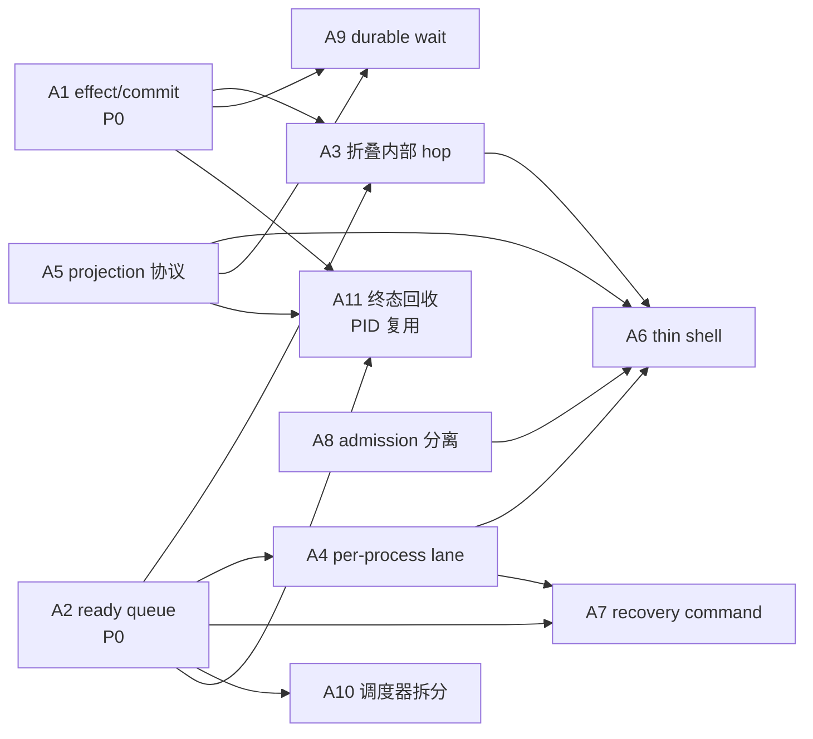
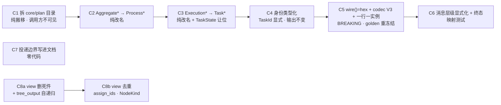

# scheduler(内核)重构设计笔记(2026-10-15)

> **状态:D1-D4 已全部拍定(C1-C8c 已落地;D4 = 暂不挪,2026-10-17)。** 决策记录见 §2.2;
> **2026-10-17 架构审计新增 A1-A11 修正波(§3.10),优先于第二波 P1/L*;A1a、A2、A11、A1b(批量确认)
> 与 A1c(effect 幂等协议)已落地,A1b 的 per-record 试点保持回退。** 任务状态见 `KERNEL_CUTOVER_NOTES.md` §11 D。
> **范围**:用户提出的 7 条 scheduler 重构思路 —— ①聚合命名 ②task 身份 ③投影出行 ④outbox 消息 ⑤立即投递 ⑥`core/plan/` 模块拆分 ⑦`core/model/view/` 的去留。
> **关系**:本文档落实 `KERNEL_CUTOVER_NOTES.md` §11 C4/C5(「先写设计再动手」),并把 §11 L1 (删 `ops`)、§10「读模型行表 `procs`/`tasks`/`vars` 的去留」两个待决项的影响面写清。
> **性质**:第 ⑤ 条原决策已被 A1b 取代(见 §2.1/§3.10),第 ③ 条**已经实现**(真实改动只是"一行一实例",依赖第 ② 条),第 ② 条是唯一动持久化格式的改动,第 ①/⑥ 条是命名与搬运。

---

## 1. 已核实事实(勿再猜,逐条 file:line)

### 1.1 命名面

| 事实 | 位置 |
|---|---|
| **仓库里没有 `Aggregate` 类型**(`grep -E '^\s*(pub )?(struct\|enum\|type\|trait) Aggregate\b'` = 0 命中) | — |
| `AggregateSnapshot{process_id, version, executions, variables, operations, outbox}` 就是聚合根,一个 pid 一份文档 | `scheduler/core/commit/aggregate.rs:24-34` |
| `ExecutionSnapshot{model_node, parent, predecessors, state, revision}` = 一个实例的持久化切片 | `scheduler/core/commit/aggregate.rs:15` |
| `Process` / `Task` 这两个名字已被 **legacy 内存视图**占用(`Process` 持 `Arc<Runtime>`+`NodeTree`+`TaskTree`,服务 `proc:get`/`Runtime::proc` 的行重建) | `scheduler/shell/process/process.rs:20`、`store/process_rows.rs:31-39` |
| `Operation` = **一次持久化 hop**,不是 task:`OperationKind` 的 9 变体含 `DeliverMessage/FireTrigger/RunPostCommit/ApplyAction/DispatchTimeout` | `scheduler/core/model/operation.rs:13-52` |
| `Action` 已被**三义**占用:①线上事件(公共面 `acts::Action` + `EventAction`)②内核决策(`ActionKind`/`ApplyActionCommand`)③运维/ACL 动词面(`proc:start`/`task:get`/`msg:ack`) | `lib.rs:45`、`event/action.rs:6-15`、`core/commit/command.rs:17-28`、`export/actions.rs:300-341` |
| `*Command` 已一致地表示"planner 的输入查询"(8 处) | `plan/{upward,branch,propagation,generation,container}.rs`、`commit/command.rs` |

### 1.2 身份面

| 事实 | 位置 |
|---|---|
| `OperationId{process_id, task_id, generation, sequence}`,其中 **`task_id` 就是模型节点 id**(`NodeId.as_str()`;根 = `"$"`) | `core/model/operation.rs:5-10`、`utils/consts.rs:27` |
| `ExecutionId{task_id, generation}` —— 同一节点重复实例靠 **`generation`** 区分,`task_id` 本身不是唯一实例身份 | `core/model/execution_graph.rs:6-9` |
| 生产侧把 node id 写进 `OperationId.task_id` 的构造点共 26 处(种子 / hop / action / fan-out / 重入 / upward) | `shell/model.rs:714-723`、`shell/mod.rs:341,858,1220,1740,1874,1937,2506,2745,2841,3064,3522,3808`、`commit/command.rs:89-94`、`plan/container.rs:449,557,662,765`、`plan/propagation.rs:176,277,304,327`、`plan/generation.rs:195`、`plan/upward.rs:84` |
| 幂等判定依赖**整份快照相等** ⇒ 实例 id 必须是 (node, generation) 的**纯函数**(随机 id 会让"模糊重试"变成"多造一个实例") | `durable/async_document_store.rs:412-432` |
| 动态 fan-out **已经**在用"id ≠ node"的形状:`ContainerChild{task_id = "<step>#item", model_node = 模板}` | `plan/container.rs:160-163`、§10「Feature B 完成」§1 |
| action 是**节点寻址**的:`action_target` 取"能接受该动作的最新 generation" | `shell/mod.rs:1240-1279`(登记边界见 §10「Feature B 完成」§4、§11 C4/C5) |
| 重复插入**会**被挡住,不静默覆盖:`ExecutionAlreadyExists` / `GenerationNotMonotonic` / `OperationAlreadyExists`(裸 `HashMap::insert` 确实会覆盖) | `aggregate.rs:562-566,575-585,618-620`(插入点 `:408-419,439-443`) |
| scope 变量键已经是**实例级**:`variables: BTreeMap<(ExecutionId, String), String>` | `aggregate.rs:28` |

### 1.3 投影面(读模型)

| 事实 | 位置 |
|---|---|
| 投影**已经**产出 `procs`/`tasks`/`vars` 三张行表(`data::Proc`/`data::Task`/`data::TaskVars`),每次提交后幂等重写 | `shell/projection.rs:141/148/224/315`、构造 `runtime.rs:555-559`、调用点 `shell/mod.rs:600-618,620-640,643-657,659-686` |
| **一个节点只有一行**:`latest: node id → ExecutionId`(最新代胜) | `shell/projection.rs:163-175` |
| `data::Task` 字段:`id, pid, tid, node_data, kind, prev, next, parent, name, state, err, start_time, end_time, timestamp, v`;`tid` = node id,`prev/next/parent` = **node id** | `store/data/task.rs:9-26`、`shell/projection.rs:331,365-380` |
| 行键 = `Id::id()` = **`pid + tid` 无分隔符直接拼** | `utils/id.rs:39-46` |
| API 形状已经把实例与节点分开:`TaskInfo.id = tid`,`TaskInfo.nid = node_data.id` | `model/info.rs:189-207` |
| `data::Op`(`ops` 集合)**生产侧无 writer/reader**,是死件(§11 L1 已排期删) | `store/store.rs:81`、§10「可靠性矩阵回归」§6 T1 |

### 1.4 消息面(outbox → Message)

| 事实 | 位置 |
|---|---|
| 主题→状态映射只此一张表(9 个主题能变消息) | `shell/message.rs:36-48` |
| 消息的 `tid` 是实例 wire(C5)、`nid` 是模型节点;`nid` 是取节点的键 | `shell/message.rs:49-58`、`facts.rs:281-287` |
| `type` 的来源是 `workflow\|branch\|step\|act`;act 载荷自 C6 显式写 `kind=act`,此前靠缺省值 | `shell/facts.rs:583-636`、`shell/message.rs:65-69` |
| act 载荷写 `kind=act`;branch 被显式抑制(忠实 legacy `Branch::init` 关 emit) | `shell/mod.rs:1511-1575`、`:1593-1603` |
| `message.created`(Created)覆盖 uses step / 无包 step / 根 `$`(kind=workflow);branch 不写 | 写入条件 `:2605-2613` + push `:2695-2705`;实测断言 `shell/tests/mod.rs:5165-5169` |
| `task.started` 是**空载荷**的 hop 注记(每 ExecuteTask 一次) | `shell/mod.rs:2572-2580`、模板 `:2782-2788` |
| `task.completed` 有 4 个写入点(叶子/容器 join/fan-out/park),互斥且带序列限定 | `:2928-2950`、`:3597-3608`、`:3661-3673`、`:3688-3734` |
| **4 个主题静默**(非 JSON 载荷):`task.propagated`、`task.reentered`、`fanout.selected`、`fanout.empty` | `plan/propagation.rs:355-370`、`plan/generation.rs:212-223`、`plan/container.rs:818-830` |
| 根节点**双发**:既走 outbox(kind=workflow)又走 `LifecycleSink` 的 `on_start`/`on_complete`/`on_error` | `shell/mod.rs:188-199,446,690-745`、`runtime.rs:545-550`、`facts.rs:267-300` |

### 1.5 投递面

| 事实 | 位置 |
|---|---|
| **A1b 前(历史)**:`deliver_plan` 在提交**之前**发本 plan 的 outbox 记录;transport 确认的 receipt 随提交落成 `Delivered`;未确认才 notify driver 的重试 pass | `shell/mod.rs:907-958`(C7 时点) |
| **A1b 起(当前)**:plan commit 写 `Pending` → 投影 → transport → **一笔** batch confirmation(`confirm_outbox_batch`);guard 失败保持 `Pending`,retry pass 重投 | `shell/operation/dispatch.rs`、`shell/mod.rs` `deliver_committed_outbox`、`durable/document_store.rs` `build_outbox_confirm_transaction` |
| tick 只是重试网:`dispatch_outbox` 扫派生索引 → 认领 → 发 → 落结果 | `shell/mod.rs:4609-4750`、`runtime.rs:512-514` |
| **outbox 不写 `messages`/`deliveries` 行**:行只由 ack 通道(`on_message` → `store_delivery`)写。没有订阅者时,"马上发出去"在存储里不留痕 | `export/channel.rs:321-336`、`runtime.rs:187-189` |
| 语义是 at-least-once:发送后、确认前崩溃,或确认丢失 guard ⇒ 记录保持 `Pending`,outbox pass 重发 | `shell/mod.rs` `deliver_committed_outbox` / `dispatch_outbox`、`notes §10「A1b 完成」` |

### 1.6 存储键面(为什么 id 的字符集不是审美问题)

| 事实 | 位置 |
|---|---|
| 索引键 = `{prefix}-{field}-{encoded_value}-{id}`;值段走 `encode_key_str`(只有 `[A-Za-z0-9]` 直通,**其余全转义**),**id 段裸拼** | `store/collection.rs:190-193`、`:876-893` |
| 写明的**不变量**:`-` 是值字符集之下唯一的定界符,值段永不出现 `-`,**ids 是 alphanumeric**,且 **`.` 绝不出现在 id 里** —— 这是 `KEY_SEP_SUCC`(`.`)组边界技巧的前提 | `utils/consts.rs:58-74` |
| 内核自己的做法就是**把 id 十六进制化**:聚合键 = `前缀 + hex(pid)`;恢复条目键 = `前缀 + hex(pid) + "." + hex(task_id) + "." + gen + "." + seq` | `durable/document_store.rs:207-226`、`core/recovery/recovery_entry.rs:28-47` |
| 现有隐患(node id 直接当 tid):用户声明 `id: "a-b"` ⇒ 行键无分隔符拼接 + `Id::from` 按 `-` 切 ⇒ 歧义;根 `tid = "$"`(0x24 < 0x2D)也不满足"ids are alphanumeric"(今天无害) | `utils/id.rs:39-46`、`consts.rs:27` |

### 1.7 模块面

| 事实 | 位置 |
|---|---|
| `core/plan` = 10 文件 / 4436 行;`container.rs` 独占 1842 行(其中 864-1842 是 `mod tests`,约 979 行) | 见 §3.6 表 |
| 每个文件同一形状:DTO/consts → Planner impl → 私有 helper → `*Error` → `mod tests` | 同上 |
| `plan/mod.rs` **只有 `pub(crate) mod`,没有 re-export**;`core::plan::` 在 `scheduler/` 之外 **0 命中** | `core/plan/mod.rs`(11 行) |
| 架构守卫只分类 **`src/scheduler` 的直接子项**(`RUNTIME_ROOT`),`PURE_MODULES = ["core"]` 是**递归**扫描 ⇒ 拆 `core/plan/` 内部对守卫星中立 | `core/architecture.rs:24-46,261-274,283` |

### 1.8 `core/model/view/**` 的现状(用户追问"要不要去掉")

`view` = `(Node, NodeContent, NodeData, NodeKind, NodeOutputKind)` + `NodeTree` + `build`/`visit` 两个自由函数簇。

| 事实 | 位置 |
|---|---|
| `NodeContent` 是 `crate::model` 四个类型的 1:1 再包一层(`Workflow(Arc<Workflow>) / Branch / Step / Act`),只为统一 `id()/name()/vars()/options()/exposes()/params()` | `view/node.rs:10-15,80-151` |
| `Node` 是 `Arc` 图:`parent/children/prev/next/chain` 全是 `Arc<RwLock<Weak<Node>>>` + 动态子节点 `nodes`;`NodeData` 是它的**扁平化 serde 形状** | `view/node.rs:41-63,65-78` |
| **`NodeTree` 从不被序列化**(`#[derive(Default, Clone)]`,无 serde);唯一被持久化的是 `NodeData` —— `tasks.node_data` 列 | `view/node_tree.rs:15`、`view/node.rs:64` |
| `NodeData` 的写者:`shell/process/task.rs:294`、`shell/projection.rs:349`;读者:`store/process_rows.rs:91`、`model/info.rs:191` | 同左 |
| **每 effect hop 建一整棵树**:`shell/scope.rs:47-66`(`process.load(&spec.model)` → `tree.node(task_id)` → `create_task`),喂 `Task::params/options` | `shell/scope.rs:48-66`、`shell/effects.rs:110-143`、`shell/predicate.rs:66` |
| **core 层没有任何策略代码用它**:`core/model/mod.rs:9` 只是 `pub(crate) mod view;`,其余 `view` 命中全在模块内部;消费者全在 shell/root/tests | `core/model/mod.rs:9`;`shell/{projection,scope,context,process/*}.rs`、`model/*`、`store/process_rows.rs` |
| 它在两条**生产路径**上:①`model:deploy` 的校验(`Workflow::valid` → `NodeTree::load`,还顺带校验 trigger/event id)②`model:get fmt=tree` 的渲染(`Workflow::tree_output`) | `model/workflow.rs:111-121,151-155`、`model_executor.rs:36,58`、`view/node_tree.rs:44-70` |
| 动态 act 簇(`dyn_build_act` + `append_node` + `Node::nodes`)的唯一生产闸门是 `Context::build_acts`,而 **effect seam 丢弃它的结果**(只读 data/env 差量);调用方是容器包 | `view/build.rs:215-243`、`view/node_tree.rs:97-110`、`shell/context.rs:255-271`、`shell/model.rs:122-133`、`shell/effects.rs:201-205`、`package/core/{block,parallel,sequence}.rs` |
| **同一份 id 分配逻辑写了两遍**:`view/build.rs` 的 `prepare_workflow_ids/prepare_step_ids/prepare_branch_ids`(私有)与 `shell/model.rs:83-113` 的 `assign_ids` | 同左 |
| 已经死掉的:`visit.rs` 全簇(只服务 `print`/`tree_output`)、`Node::from_str`(仅测试)、`NodeTree::build`+`build_workflow`(仅测试)、`build.rs:183-213` 注释掉的 `build_act`、`Workflow::print`(无调用者) | 见"删死件"列的 file:line |
| `visit.rs` 里有**真缺陷**:每个 `Visitor` 克隆 `Box<VisitRoot>`,`visit()` 只改克隆 ⇒ `visits` 计数恒 0 ⇒ 循环 `next` 链在 `print`/`tree_output` 里无界递归 | `view/visit.rs:21-23,45-65,75-80,100-105` |
| `crates/acts` 之外(CLI/server/channel/packages/plugins/examples)**零命中**(`acts-store` 测试里只有字面字符串 `node_data`) | — |

---

## 2. 决策

### 2.1 已定

- **第 ⑤ 条(投递)**:**已被 2026-10-17 架构审计的 A1b 取代**。C7 当时的「发在提交前」不再是目标;目标改为「先提交 outbox 记录为 Pending,再由 outbox dispatcher 发送并**批量确认**」。A1b 落地前代码仍是旧顺序,但不得再把旧顺序当契约(见 §3.5、§3.10)。
  per-record claim/confirm 试点已回退(写放大不可接受),实现必须批量确认或把 outbox 状态移出 aggregate。
- **第 ① 条的前提**:legacy `Process`/`Task`/`Action` 不参与命名决策(迁移后移除),因此终态名字**现在就按终态取**;临时并存(`ProcessSnapshot` vs shell `Process`)可接受,层不同且守卫已在挡越层。
- **第 ② 条的铁律**:实例 id 必须是 `(node, generation)` 的**纯函数**。理由见 §1.2 的 `AlreadyCommitted` 条目 —— 这不是风格问题,是"会不会多造一个实例"的问题。
- **第 ③ 条**:不改"投影已存在"这件事,真实改动只有"一行一实例",且它**依赖第 ② 条**。
- **存储与 PID 复用(2026-10-17 追加)**:存储只服务于崩溃/停止/异常后的恢复,不做历史归档或长期查看;
  run 终态、所有消息投递/结算、且无未决 operation 后,回收 `ProcessSnapshot`、投影行、recovery/outbox 索引和 workdir;
  回收后同一 pid 可再次启动,旧 pid 的重复执行/迟到消息由业务系统按业务键去重。设计见 A11。

### 2.2 决策记录(D1/D2/D3/D4 均已拍)

**D1 —— 命名词汇:取 `{Process, Task, Operation}`(推荐),不取 `{Action, Task}`。
→ 已拍(2026-10-16,用户裁决):`{Process, Task, Operation}`。执行见 `KERNEL_CUTOVER_NOTES.md` §11 C2 / §10「C2 完成」
(`Aggregate* → Process*` 已落地;C3 的 `Execution* → Task*` 是本裁决的第二半)。**

- `Action` 已三义(§1.1),扩成第四义会同时污染公共面 `acts::Action`、内核 `ActionKind`、ACL 动词面。
- `Operation → Task*` 会把 `DeliverMessage/FireTrigger/RunPostCommit` 变成"Task 的一种"(§1.1)。
- 用户心里的 task = **`Execution*`**(节点的一个实例),所以正确的改名方向是 `Execution* → Task*`,而不是 `Operation* → Task*`。
- `*Command` 保持不动(它已经一致地表示 planner 输入,改成 `*Action` 语义是反的)。

**D2 —— 实例 id 的派生与形态:`TaskId{node, generation}` + hex `wire()`。**
→ **已拍(2026-10-16,用户裁决):乙 —— `sha256` 定长 32 hex 摘要**,C5 执行;同时确认**接受 golden 全量重冻结(BREAKING)**;
恢复条目旧键成孤儿的处理口径:**先登记不实现,与 §11 L1(死掉的 `ops` 族孤儿)同批拍**。
执行见 `KERNEL_CUTOVER_NOTES.md` §12(C5 提示词)与 §10 的「C5 完成」(落地后)。

```rust
// 身份:实例 = 节点的第 generation 代(确定性派生,不是 nanoid)
pub(crate) struct TaskId { node: NodeId, generation: u64 }

impl TaskId {
    // 甲(可逆):定宽 gen 前缀 + hex(node)
    fn wire(&self) -> String { format!("{:016x}{}", self.generation, hex(self.node.as_str())) }
    // 乙(不可逆,定长 32):摘要;sha256_hex 已在 core/commit/aggregate.rs:812
    // fn wire(&self) -> String { sha256_hex(&[pid,0x00,node,0x00,gen_le].concat())[..32] }
}
```

| | 形态 | 可逆 | 长度 | 前端能猜 | 反解成本 |
|---|---|---|---|---|---|
| 甲 | `[0-9a-f]`,定宽 16 hex 的 gen 在前 | ✅ O(1) | 16 + 2×node | 解 hex 即还原(只是不显眼) | 无(`parse()` 一处) |
| **乙(推荐)** | 32 位 hex 摘要 | ❌ | 恒 32 | 不能 | 查 snapshot |

推荐**乙**:定长 ⇒ 键不随用户起的 node 名长度膨胀(甲下 40 字符的 node 名 → 96 字符 tid,`tasks` 的 6 个索引字段 + `vars` 2 个全跟着涨);且"tid 反推 node"在内核里**本来就不需要** —— 所有 `NodeId::parse(task_id)`/`task_id == node` 的调用点手上都握着 `&OperationId`/`&ExecutionId`,把参数换成 `&TaskId` 即可(§1.4 的 `act_message_payload`/`node_kind_and_name`),最热的 `action_target`(§1.2)今天**本来就在扫** `executions.keys()`,把字符串比较换成 `wire()` 比较时复杂度不变。

**⚠ 与旧建议的冲突(必须同时拍)**:一旦定了"tid 一律 hex",上一轮讨论里"gen==0 沿用裸 node id 以保证 golden 不变"就**作废** —— 同一字段混两种形态(`s2` 与 `9f3a…`)会让"前端靠猜"的问题原样回来。所以 D2 实际是:**接受全量重冻结 golden(BREAKING)** vs **保留 node id 可读性**。推荐前者(一次做完)。

**D3 —— `data::Task.{prev,next,parent}` 的取值。**
→ **已拍(2026-10-16,用户裁决):保持 node id**;用户追问"同一节点重复创建多次会不会乱"的澄清(记录在案):
**不乱** —— 这三列说的是**模型链拓扑**(节点间"谁接谁"),与代数无关:同一节点创建多少次,`step1.next = step2` 都不变。
"实例"维度由 C5 的行按实例承担:行键 = `pid + wire()`(每实例一行,不再 `latest` 折叠),`tid` 列区分同节点的各代,
`nid`(= `node_data.id`)列保留模型节点。prev/next/parent 若改成实例 tid 反而丢信息(模型链没有"代"),还逼前端解 hex。

推荐**保持 node id**(它们描述的是模型链,legacy 的 `parent` 指 step 的 tid 但读模型另有 `node_data.id`)。若改成实例 tid,前端要 join 就得解 hex,与"别让前端猜"的目标相反。

**D4 —— `core/model/view/**` 是否挪位(§3.7 (c))。**

→ 已拍(2026-10-17,用户裁决):**暂时不挪,后续考虑**。`view` 保留在 `scheduler/core/model/view`;
接受"core 里住着一个读模型关注点"这一边界(§3.7(c))。后续重评放在 §11 L11/L12 之后(它们会删掉 `view` 的约 3/4);
若届时仍需挪,优先 (c2) `crate::model::view`,不取 (c1)。effect seam 已验证成立,见 `KERNEL_CUTOVER_NOTES.md` §10「C8c 完成」。

不挪的代价与依据:动路径的收益低于风险,且 `NodeTree`/`Node` 会在 L11 被删;要挪就应并入 L11,而不是先搬后删。

---

## 3. 设计

### 3.1 身份模型(核心)

```rust
// core/model/task.rs(新;由 execution_graph.rs 演化)
pub(crate) struct TaskId { node: NodeId, generation: u64 }   // 实例身份:确定性、纯函数
pub(crate) struct TaskSnapshot {                             // 现在的 ExecutionSnapshot
    id: TaskId,
    parent: Option<TaskId>,
    predecessors: Vec<TaskId>,
    state: TaskState,          // 现在的 ExecutionState
    revision: u64,
}
pub(crate) struct ProcessSnapshot {                          // 现在的 AggregateSnapshot
    process_id: String,
    version: ProcessVersion,
    tasks: HashMap<TaskId, TaskSnapshot>,                    // 现在是 executions
    variables: BTreeMap<(TaskId, String), String>,
    operations: HashMap<OperationId, OperationRecord>,       // 不变(它是 hop)
    outbox: HashMap<OutboxId, OutboxRecord>,                 // 不变
}
pub(crate) struct OperationId {                              // task_id 换类型,语义收紧
    process_id: String,
    task: TaskId,                                            // 现在是 task_id: String(= node id)
    sequence: u64,                                           // 同一实例内的第几次 hop
}
```

- **`node` 只存在于 `TaskId` 里一次**:不做"平铺 `node_id` + `task_id` 两个字段"——那会引入必须校验的冗余(`validate()` 今天已有 `OperationIdentityMismatch`/`ForeignOperation` 三条同类检查),还会让恢复条目键(§1.6)近乎翻倍。要 node 用 `id.task.node()`,要实例用 `id.task`,要线上/行键字符串用 `id.task.wire()`。
- `generation` **继续作为节点内计数留存**(admission/reentry/`next_generation` 都要它),只是不再是身份的组成部分之一 —— 它被吸收进 `TaskId`。
- **`NodeId` 保持自由**(可含 `#`:合成器产出 `<step>#item`,用户模型也可声明),**`wire()` 必须纯 hex**。两套字符集分开正是这次要修的:今天它们恰好是同一个字符串。

**四条不变量(验收口径)**

1. `wire()` 只含 `[0-9a-f]` ⇒ 满足 §1.6 的"ids are alphanumeric / `.` 绝不出现在 id 里"。
2. `wire()` 对 `(node, generation)` **单射** ⇒ 两个实例不可能撞 id。
3. `wire()` 是**纯函数**且不依赖进程内状态(禁 nanoid / uuidv4 / 时间戳 / 自增计数)⇒ `AlreadyCommitted` 的整快照相等、`canonical_aggregate_bytes`/`digest`、CAS 输家重 plan 全部照旧成立。
4. 同一 `TaskId` 反复 `wire()` 稳定。

**`wire()` 的落点(全部是"字符串 ↔ 结构"的边界)**

| 落点 | 现在 | 改成 |
|---|---|---|
| 消息 `tid`/`nid` | node id(`shell/message.rs:96-112`) | `tid = wire()`,`nid = node`(明文,保持不变) |
| action 目标 | `action_target(task_id: &str)` 字符串比较(`shell/mod.rs:1240-1279`) | 比较 `wire()`;选法**不动**(§11 C4/C5 的告诫) |
| 行键 | `Id::new(pid, node_id)`(`projection.rs:331`) | `Id::new(pid, &wire)` |
| 恢复条目键 | `hex(pid).hex(task_id).gen.seq`(`recovery_entry.rs:28-47`) | `hex(pid).wire.seq`(gen 已进 wire) |
| 模型查找 | `NodeId::parse(task_id)`(`shell/mod.rs:3127`)、`node_kind_and_name(model, tid)`(`facts.rs:596`) | 直接收 `&TaskId`,查 `TaskSnapshot.node` |
| 根查找 | `tid == "$"`(`facts.rs:23-27`、`shell/mod.rs:551-556,700-704`) | 结构化(根 = 种子的那个 TaskId),`$` 退回 `NodeId` 层面 |
| 客户端面 | `tid` = node id(CLI 列 / `task:get` / `MessageInfo.tid` / gRPC `data`) | `tid` = `wire()`,节点用 `nid` |

**持久化(必须与身份同批)**

- `ACTSPV2` → **V3**:每个 `TaskId`/`OperationId.task` 落 `wire` 字符串 + node 字符串 + gen(`snapshot_codec.rs:210-230,362-368` 一带);V2 文档 **upcast**:`instance id := 该代 node 的 wire`(退化等价,行为不变)。
- 恢复条目索引键格式随之变 ⇒ 老库遗留的旧键成**孤儿**(与 §11 L1  `ops` 孤儿同类),处理策略与那一项一起定。

### 3.2 命名表(终态)

| 现在 | 终态 | 备注 |
|---|---|---|
| `AggregateSnapshot` | `ProcessSnapshot` | 根;`Aggregate*` 全族跟改(`AggregateVersion`/`AggregateRepository`/`AggregateDocumentCodec`/`AggregateEnvelope`/`AsyncAggregateRepository`/`MemoryAggregateRepository`) |
| `ExecutionId` | **`TaskId{node, generation}`** | 实例身份 |
| `ExecutionSnapshot` | `TaskSnapshot` | |
| `ExecutionState` | `TaskState` | 需把现有 `core::model::task_state::TaskState`(legacy 12 态:`None/Pending/Interrupt/Error`)改名让位(如 `NodeState`);它是 `pub(crate)`(`lib.rs:59`),不落到线上 |
| `ExecutionGraph`/`ExecutionNode` | `TaskGraph`/`TaskNode` | |
| `Operation*` | **不变** | 它是 hop,不是 task |
| shell `Process`/`Task` | 不动,等删 | 与 `ProcessSnapshot` 临时并存 |

> **C2/C3 已落地(2026-10-16)**:上表第一行(`Aggregate*` 全族)与其后的 `Execution*` 行都已按其"终态"列执行
> —— `AggregateSnapshot → ProcessSnapshot`、`ExecutionId → TaskId`、`ExecutionState → TaskState`(旧 `TaskState` 让位成 `LegacyTaskState`)、
> `ExecutionSnapshot → TaskSnapshot`、`ExecutionGraph/Node → TaskGraph/Node`;模块随之成了 `core::commit::process` / `core::model::task_graph`。
> 逐项映射、边界(字面量/散文不动)与验收见 `KERNEL_CUTOVER_NOTES.md` §10「C2 完成」「C3 完成」;
> `TaskId`/`OperationId` 的**类型化**(`node: NodeId`、`OperationId.task: TaskId`、`wire()`)是 C4,`shell Process/Task` 仍按"不动,等删"。
> 另:`core/commit/{aggregate,command}` 已按 C1 的办法目录化(见 §10「C1b 完成」);
> `model_graph::NodeKind` 已恢复 4 值并**如实标注**(policy 图装的是根 + 顶层 step;分支/act 是计划级 fan-out),见 §10「NodeKind 恢复 4 值」。

### 3.3 投影(第 ③ 条)

- 目标:一行 = **一个实例**。`latest: node → ExecutionId`(最新代胜)的折叠取消,`tasks` 行键 = `pid + wire()`。
- `node_data`、`kind`、`name` 照旧从模型取;`tid = wire()`、`node_data.id = node`(API 契约:`nid` 找节点、`tid` 指实例,`model/info.rs:189-207` 已经是这个形状)。
- D3 决定 `prev/next/parent` 的取值。
- `ops` 是死件:删它归 §11 L1 ,**不要**在本轮顺手删(避免一个 commit 混两件事)。

### 3.4 消息(第 ④ 条;2026-10-17 C6 落地)

现状(§1.4)已经能发 Created/Completed 三层级;C6 把纪律补齐:

1. **层级显式化(已做)**:act 载荷与 task 载荷都写 `kind`;层级词汇复用 `crate::NodeKind`(`workflow|branch|step|act`,与行/模型同一真值来源),
   `node_kind_and_name` 对 `uses` step 回答 `NodeKind::Act`。对外字符串逐字节不变:`Message.r#type` / channel / gRPC 仍是这四个词(旧记录缺 `kind` 时
   `message_from_record` 仍以 `act` 兜底)。**行 `kind` 故意不跟**:读模型行对 `uses` step 仍写 `step`(见 `projection::project_task` 的注释;
   读模型契约),消息词汇的 `act` 只属于消息面。
2. **静默 topic(已拍:保持静默)**:`task.propagated`、`task.reentered`、`fanout.selected`、`fanout.empty` 四主题**不加状态载荷** ——
   legacy 对这些转换没有事件,静默是决策,不是遗漏。它们是 outbox 的投递/诊断记录;`message_from_record` 不识别即返回 `None`(transport 记为 lifecycle receipt)。
3. **根节点双发(确认保留)**:outbox(`kind=workflow` 的 `message.created`/终态)与 `LifecycleSink`(`on_start`/`on_complete`/`on_error`)**都**保留,
   = legacy `on_task` + `on_proc` 的忠实复刻;两条路的载荷不同、用途不同,互相不替代。
4. **每终态恰一条(已做)**:`message_from_record` 的 9 项 topic→state 表仍是唯一真值源;测试补两处 —— 9 主题的完整映射表,以及
   `TaskState` 每个终态必须命名一个主题(穷尽 match:新增状态在编译期就迫使决定),并钉住 `tid` = 实例 wire / `nid` = 模型节点的契约(C5 的 BREAKING 承接)。

### 3.5 投递(第 ⑤ 条;2026-10-17 C7 定稿,**同日被 A1b 取代**)

> **2026-10-17 更新,2026-10-18 落地**:下面的第 1 条是 C7 时点的现状,不再是终态。A1b(§3.10)已把投递移到
> 提交之后:记录先提交为 `Pending`,投影后由 transport 发送,再由**一笔** batch confirmation 落结果;
> per-record claim/confirm 试点保持回退(写放大不可接受),不得原样重试。
> 保留本节是为了记录当时的 at-least-once 决策与“无 handler 不留行”边界;实现以 A1b 的批量版为准。

两条边界都是**契约**,不是实现细节;本笔零代码,以下引用均以 C7 提交状态为准:

1. **at-least-once(已定)**:`deliver_plan` 在提交**之前**发本 plan 的 outbox 记录
   (`shell/mod.rs:804-864`;调用点 `operation/dispatch.rs:37`,紧接着才是 `commit_transition`);
   transport 确认的 receipt 随这次提交落成 `Delivered`(`core/commit/aggregate/commit.rs:100-112`),
   未确认的记录提交为 `Pending`(`shell/mod.rs:852-857`),由 driver 的重试 pass
   (`dispatch_outbox`,`shell/mod.rs:1880-1971`)在下一次通知或 tick 再发(`shell/mod.rs:666-695`)。
   **deliver 与 commit 之间崩溃 ⇒ 重发**,与 effect seam 是同一个窗口(`shell/mod.rs:812-814`)。
2. **无 handler 时不留行(已定)**:outbox 只把记录写进聚合(`core/commit/aggregate/commit.rs:88-115`),
   **不写** `messages`/`deliveries` 行;这两张表的写者只有 ack 通道 —— `Channel::on_message` 注册的 handler
   (`export/channel.rs:149-172`)调 `deliver`/`store_if`(`export/channel.rs:266-346`,`ack` 条件在 `:323`),
   经 `Runtime::store_delivery`(`runtime.rs:186-194`)→ `writebehind::store_delivery`(`store/writebehind.rs:431-446`)
   → `Store::store_message_delivery`(`store/store.rs:590-608`)落行。没有订阅者时,"马上发出去"是内存事件,
   不是持久化事实。

**取舍(已定)**:发在提交前 = 延迟最低、与 effect seam 同序(一个 operation 一次 commit 一次投递,不等 tick);
代价是重复窗口 —— **消费者必须幂等**。

### 3.6 模块划分(第 ⑥ 条)

| 文件 | 行 | 内容分段(要拆的理由) |
|---|---|---|
| `container.rs` | 1842 | 1-42 文档/imports · 49-138 flow/sign 事实读取 · 140-231 7 个 DTO · 233-682 `ContainerPlanner` · 684-825 8 个私有 helper · 833-861 `ContainerError` · **864-1842 tests** |
| `propagation.rs` | 734 | 19-75 DTO · 83-377 Planner · 378-486 `JoinReadiness`+readiness helper · 487-514 Error · 515-734 tests |
| `timeout.rs` | 568 | 42-163 marker/claim 事实 · 165-234 dispatch · 236-568 tests |
| `generation.rs` | 614 | 17-231 Planner · 232-257 Error · 258-614 tests |
| `upward.rs` | 253 | 28-100 Planner · 101-117 Error · 118-253 tests |
| `branch.rs` | 152 | `PredicateValue`(全仓耦合最多,约 31 处) · DTO · Planner(无 tests,覆盖在 `core/coverage.rs`) |
| `concurrency.rs` 95 / `execution_admission.rs` 100 / `cron.rs` 67 | ≤100 | **不动**(已够小;`cron::Cron` 是唯一 `pub` 项且被 scheduler 面 re-export) |

拆法:

```
core/plan/container/{mod.rs, flow.rs, child.rs, fanout.rs, join.rs, catch_join.rs, errors.rs, tests/}
core/plan/propagation/{mod.rs, join.rs, cascade.rs, errors.rs, tests.rs}
core/plan/timeout/{mod.rs, marker.rs, dispatch.rs, tests.rs}
core/plan/generation/{mod.rs, errors.rs, tests.rs}
core/plan/upward/{mod.rs, errors.rs, tests.rs}
core/plan/branch/{mod.rs, errors.rs}
```

**关键技巧(让调用方看不见)**:`mod.rs` 里 `pub(crate) use fanout::ContainerFanoutCommand;` 等原样 re-export ⇒ `shell/mod.rs` 里那 ~60 处 `plan::container::ContainerPlanner` **一行都不用动**;`PredicateValue` 留在 `branch/mod.rs` 保持路径 `plan::branch::PredicateValue` 不变。守卫中立(§1.7),`container.rs` 的 tests 按主题归位(不要搬到一个大 `tests.rs` 里换个地方堆)。

### 3.7 `core/model/view/**` 的去留(第 ⑦ 条,用户追问)

**结论:`view` 整体不可删 —— 它不是 legacy 残留,而是"读模型形状 + 导入期索引";但它内部有整簇死件和一处重复实现,该做的是"瘦身",挪位与替代另行登记。**

不可删的四条(每条都有一个"只有它有"的能力,§1.8 有 file:line):

1. `NodeData` 是 `tasks.node_data` 列的**持久化形状**(写 `shell/process/task.rs:294`/`shell/projection.rs:349`,读 `store/process_rows.rs:91`/`model/info.rs:191`)——删它要同时换列格式 + 老库 upcast。
2. `NodeTree::load` 是 **`model:deploy` 的校验实现**(`Workflow::valid` → `model_executor.rs:36`),还顺带校验 trigger/event id(`view/node_tree.rs:44-70`)。规则可以搬,但搬 ≠ 删。
3. `tree_output` 是**生产 API**(`model:get fmt=tree`,`model_executor.rs:58`)。
4. **每 effect hop 建一整棵树**(`shell/scope.rs:47-66`)—— 它是热路径,不是旁路件。

可做/可登记的四档(按风险升序):

| 档 | 内容 | 风险 |
|---|---|---|
| **(a) 删死件** | `visit.rs` 全簇(只服务 `print`/`tree_output`,且它自带缺陷:每 `Visitor` 克隆 `Box<VisitRoot>` ⇒ 计数恒 0 ⇒ 循环 `next` 链无界递归);`Node::from_str`(仅测试);`NodeTree::build`+`build_workflow`(仅测试);`build.rs:183-213` 注释掉的 `build_act`;`Workflow::print`(无调用者)。`tree_output` 改成沿 `Node.children` 自递归(顺手修掉那个递归缺陷) | 低:纯删 + 一个渲染函数换实现(无测试 pin 其输出,只有 `Node::from_str` 的往返测试) |
| **(b) 去重** | ①**id 分配写了两遍**:`view/build.rs` 的 `prepare_workflow_ids/prepare_step_ids/prepare_branch_ids` 与 `shell/model.rs:83-113` 的 `assign_ids` 合一 ②`projection.rs:323-350` 的 `node.kind()/name()` 换成已有的 `facts.rs:595-613 node_kind_and_name`(含根 `("workflow", model.name)`)③`NodeKind` 两份合一(`view::NodeKind` 4 变体 vs `model_graph::NodeKind` 2 变体) | 中:单一来源,行为等价 |
| **(c) 挪位(D4 已拍:暂时不挪,2026-10-17;后续重评)** | `view` 今天住在 `core/`,而 core 层**零策略代码**用它(只有 `core/model/mod.rs:9` 一行声明),消费者全在 shell/root/`crate::model`/`crate::store`。两个方向:(c1) 挪进 `scheduler/shell/` —— 零守卫改动,但 `crate::model → scheduler::shell` 的方向更难看(该依赖今天已存在:它就是 `crate::model → scheduler`);(c2) 挪成 crate 级 `crate::model::view`(与 `model_graph` 对称)——方向最正,但要给守卫新增一条"谁可以命名 `model::view`"。**裁决:暂不挪;后续重评优先 c2、不取 c1。** | 低-中:路径 + import(+ 守卫条目);本轮零代码 |
| **(d) 需替代先行(登记;已收敛为 §11 L9-L12)** | ①`shell/scope.rs` 的"每 hop 建整棵树"换成轻量 `ModelNode` 视图(要带 `params/options/exposes/kind/name`,step 与 branch 都要)→ **L10** ②`node_data` 列形状重定(**独立,仍登记;NodeData/NodeContent 在 L9-L12 中必须保留**)③`Workflow::valid`/`tree_output` 搬到 `Workflow` 上(~40 行规则)→ **L11** ④`Task` 不再持 `Arc<Node>`、`Process`/`Task` 退役 → **L12** ⑤动态 act 簇与 `Context::build_acts` → **L9**:**2026-10-17 已验证成立** —— `effects::run` 只取 `task.data()`/`process.env()`/包 `outputs`,不读 tree;`projection` 从 durable model 重建树;三个容器包调用方的产物被丢弃,而 `materialize_container_acts` 已在 import 时重写同一形状 | 高:动热路径与持久化列 |

> 注意:`view` 与 `model_graph.rs` 是**两份模型图、两种用途**(`view` = 导入期 id/索引 + 读模型形状 + 打印/校验;`model_graph` = 纯策略面的 `NodeId`/`successor`),不要合成一份 —— 本节的 (b)① 只合并"重复的 id 分配",不合并这两份图。
>
> `Process`/`Task`/`NodeTree` 的退役按 **§11 L9→L12** 四笔执行(Phase 0 死件 → headless `ScopeTask` → model 直出 view → 读 API 改行查询并删类型);`NodeData`/`NodeContent` 是持久化形状,始终保留。**D4 已拍为暂不挪(2026-10-17)**;后续重评建议放在 L11/L12 之后,并直接按 c2 落点一次完成——`NodeTree`/`Node` 会在 L11 被删,先搬后删是白工。

---

### 3.8 host 的 hop 分相(H1,2026-10-16;H3 起该词改为 operation,见本节末)

**问题(用户)**:`KernelHost::execute_one` 曾是一个 745 行的 `match OperationKind`,把「准备(load/place/park 判定/预检/claim)」、各 kind 的业务(解析、跑包、求值)、各 kind 的计划(状态变更/后继操作/outbox)、以及提交后的收尾(deliver/commit/wake/lifecycle/投影/槽位)全部串在一个函数里;客户端动作路径(`apply_action_once`)为此另写了一份同样的提交→唤醒→投影→槽位,两处容易漂移。

**终态:四阶段 + 按 kind 的 driver**。`shell/operation/` 是唯一知道「一个 operation 怎么走完」的地方:

| 阶段 | 位置 | 内容 |
|---|---|---|
| 1 准备 | `operation/prepare.rs` | parked 快路径、槽位策略(`place_run`)、按 kind 的 **pre-check 策略**(`ActOperation::precheck`,今天只有计时器的 idle round)、`ClaimAndPrepare` 认领 —— 一次原子事件交回「本 hop 唯一权威快照」。`Slot::Policy`(驱动自己的 operation)/`Slot::Direct`(客户端动作:决策已持久化,不当被 parked 队列拦住) |
| 2 执行 | `ActOperation::run` | 该 kind 自己的工作,返回 **`Outcome`**(kind 自己的词汇:`Start`/`Effect`/`TimeoutRound`/`Planned`/`Nothing`) |
| 3 计划 | `ActOperation::next` | 把 `Outcome` 折成 **`TransitionPlan`**(状态变更、后继操作、outbox 记录) |
| 4 分发 | `operation/dispatch.rs` | deliver → commit(冲突 → 释放 claim + `ECONFLICT`)→ wake → lifecycle → 行投影(`Touched`/`Whole`)→ 槽位结算 |

- **trait 是 `ActOperation`**(`#[async_trait]`,`Send + Sync`;H1 落地时名为 `OperationDriver`,H2 起改此名),三个方法 `precheck`/`run`/`next`;`driver(kind)` 是唯一的查表入口,驱动侧不再 `match OperationKind`。driver 不持状态:`KernelHost` 显式传入,事实都在 `Pending`/`Claimed`/`Hop` 上下文里。
- **每 kind 一模块**:`operation/task.rs`(ExecuteTask)、`operation/action.rs`(ApplyAction)、`operation/timeout.rs`(DispatchTimeout)、`operation/cascade.rs`(SkipTask/AbortTask)、`operation/propagate.rs`(PropagateTask)、`operation/reentry.rs`(ReenterTask)。kind 自有的规划器(入口检查、`start_plan`、`completion_plan`、`timeout_round/plan`、容器 fan-out、catch fan-out、上行/join 计划…)随 arm 一起搬进对应模块,仍以 `impl KernelHost` 方法存在(最小改写),因此同模块内互调无需放宽可见性。
- **`Hop` 上下文只服务 trait**:`{id, claim, task_id, task, snapshot, now_ms}`;kind 内部的规划器保持既有签名(拆出上下文不会让签名变清楚),driver 在入口处解构。
- **`Outcome` 的边界**:`Nothing` 表示「claim 之后发现其实无事可做」(计时器在预检与 claim 之间转 idle):claim 归还(next tick 重新推导),`next` 不会被调用。
- **客户端动作走同一条流水线**:预检(命令校验 + Back/Cancel/catch 拒绝)→ 意图提交(`__action` 持久化)→ `prepare_operation(Slot::Direct)` → 同一 `run`/`next` → `dispatch_operation(Projection::Whole)`,因此动作路径不再持有自己的 commit/wake/投影/槽位代码;claim fence 改由**操作自身的 attempt** 派生(与驱动路径同源),`apply_action_once` 的 `attempt` 参数随之删除。
- **未动**:`OperationKind`/`OperationEvent`/状态机/`core/plan/**`/codec/`wire()`/读模型行表口径。CAS 冲突的错误类别从 `Runtime` 收紧为 `conflict`(ECONFLICT)——这是驱动与动作两条路径共用一个冲突出口后的必然修正(动作重试循环靠 `is_conflict` 判定)。

**行为差异(登记)**:①动作路径现在也上报 lifecycle(事件集合不变、`ReportedRuns` 去重,但「进程终态」可能由动作自己的提交上报);②动作路径的槽位结算改用提交返回的快照(原为额外一次聚合读);③`KernelHost::snapshot` 现在只服务测试(`#[cfg(test)]`)。

**H3 词汇变更(2026-10-16)**:本节写作时的 `hop` 一词已全面改为 `operation` —— 模块 `shell/hop/` → **`shell/operation/`**、
上下文结构 `Hop` → **`Operation`**(`Claimed::hop()` → `Claimed::operation()`)、`prepare_hop`/`dispatch_hop` → **`prepare_operation`/`dispatch_operation`**、
`hop_message_payload`/`task_hop_plan`/`attach_hop_message` → **`operation_message_payload`/`task_operation_plan`/`attach_operation_message`**、
探针 `shell::hop_trace` → **`shell::operation_trace`**。上面表里的路径已是新名;记录见 `KERNEL_CUTOVER_NOTES.md` §10「H3 完成」。

---

### 3.9 `core/plan/**` 的计划抽象:一个 `ActPlan` trait,每个计划/判定一个类型(H2,2026-10-16)

**问题(用户)**:`core/plan` 这边是 6 个 `*Planner` 静态方法命名空间,签名各不同
(`ContainerPlanner::{plan_fanout,plan_join,plan_catch_join}`、`PropagationPlanner::plan`、`GenerationPlanner::plan_reentry`、
`UpwardPlanner::plan_upward`、`BranchPlanner::decide`、`GenerationAdmissionPolicy::decide`、`timeout::{candidate,dispatch,admit}`)——
上层每处都要点名具体实现,没有统一契约。

**终态:每个计划/判定 = 一个类型,实现 `ActPlan`**。trait 只有四个关联项(两个 GAT + 两个普通项):

```rust
pub(crate) trait ActPlan {
    /// 本 plan 读什么:快照,以及它另外需要的形状(今天:重建的任务图);只读命令的用 `()`。
    type Reading<'a>;
    /// 调用方为本 plan 从读取视图里整理出的输入(可借用读取视图)。
    type Command<'a>;
    /// 产物:整张计划、一个判定,或调用方折入的片段。
    type Output;
    /// 本 plan 自己的拒因(不是引擎错误:shell 在调用点映射)。
    type Error: std::fmt::Display;

    fn plan(reading: Self::Reading<'_>, command: &Self::Command<'_>) -> Result<Self::Output, Self::Error>;
}

/// 不会拒绝的 plan 的输出:`Result` 恒为 `Ok`。
pub(crate) fn infallible<T>(planned: Result<T, std::convert::Infallible>) -> T;
```

| 类型 | 旧身 | Reading | Output |
|---|---|---|---|
| `container::Fanout` | `ContainerPlanner::plan_fanout` | `&ProcessSnapshot` | `TransitionPlan` |
| `container::Join` | `ContainerPlanner::plan_join` | `(&TaskGraph, &ProcessSnapshot)` | `Option<(StateChange, OperationIntent)>` |
| `container::CatchJoin` | `ContainerPlanner::plan_catch_join` | `(&TaskGraph, &ProcessSnapshot)` | `Option<CatchJoinOutcome>` |
| `propagation::Propagate` | `PropagationPlanner::plan` | `(&TaskGraph, &ProcessSnapshot)` | `TransitionPlan` |
| `generation::Reenter` | `GenerationPlanner::plan_reentry` | `(&TaskGraph, &ProcessSnapshot)` | `TransitionPlan` |
| `upward::Upward` | `UpwardPlanner::plan_upward` | `&ProcessSnapshot` | `(Vec<StateChange>, Vec<OperationIntent>)` |
| `branch::Decide` | `BranchPlanner::decide` | `()` | `BranchDecision` |
| `timeout::Round` | `timeout::candidate` | `&ProcessSnapshot` | `TimeoutCandidate` |
| `timeout::Dispatch` | `timeout::dispatch` | `&ProcessSnapshot` | `TimeoutDispatch` |
| `task_admission::Admit` | `GenerationAdmissionPolicy::decide` | `()` | `AdmissionDecision` |
| `concurrency::Admit` | `concurrency::admit` | `()` | `Admission` |

**三条设计取舍(都不是风格问题)**

1. **`Reading` 是值,不是 `&Reading`**:读取视图就是引用(或引用的元组),按值传 ⇒ 不用图的两个入口(fan-out / upward)
   **零额外开销**,要图的入口照旧拿到调用方已经建好的那张图(不会为了签名统一而多建一次图 —— 那会落在容器完成与 timeout 派发的热路径上)。
2. **`Command` 也是 GAT**:允许**借用**命令 —— `timeout::Round` 的命令是 `RoundCommand<'a>{ owner: &'a TaskId, branches: &'a [TimeoutBranch] }`,
   免得计时器每 tick 克隆整张分支表;字段本来就 owned 的命令(`ContainerFanoutCommand` 等)写 `type Command<'a> = X;` 即可。
3. **`Error: Display` + `infallible`**:判定型计划(`Decide`/`Round`/`Dispatch`/`Admit`)不会拒绝,`Error = Infallible`;
   契约仍然只有一份,由调用点的 `infallible(..)` 解开 —— 不搞"会失败的走 Result、只会回答的直接返回"两套形状。

**边界(不是计划,保持原样)**:`timeout::{claimed, claim, cost_ms, has_live_child(ren), start_write}` 与 `branch::PredicateValue`
是事实读写与取值;**`cron::Cron` 是带状态的值类型**(`parse`/`next_fire_millis`),不是"某个类型实现的一个计划"。

**零行为变更**:判定逻辑、错误类型、错误消息、DTO 字段全部逐字保留;`*Planner`/`GenerationAdmissionPolicy` 整体删除,不留兼容壳。

---

### 3.10 架构修正 A1-A11(2026-10-17 审计)

> 审计结论:分层方向(`Core / Durable / Shell`)保留,不需要推翻重写。问题集中在六处:
> **外部 effect 与提交的顺序、正常路径的活性来源、同一 Process 的写者模型、投影的版本协议、Shell 仍承担的状态机语义、
> 以及终态 ProcessSnapshot/投影/索引的回收与 PID 复用。**
> 任务编号 `A1…A11` 与审计条目对应;状态、依赖和验收只在 `KERNEL_CUTOVER_NOTES.md` §11 D 维护,本节只写设计。

#### A1 — effect/commit 边界(最高优先级)

**现状(§1.5、§3.5)**:`ClaimAndPrepare` 在 effect 之前落盘,方向正确;但 effect 之后的 plan commit 若丢失 CAS,
`dispatch` 会释放 claim 让 recovery 自动重试,`apply_action_once` 的 `next` 失败也会释放 claim。此时包 effect 可能已经执行,
重试会重复外部副作用。outbox 记录仍在本 plan 提交**之前**发送,注释里的 at-least-once 窗口是同一问题。

**目标协议**:

```text
Command
  -> Commit { aggregate changes, effect intent, outbox Pending }
  -> Effect executor
  -> EffectObservation
  -> Commit result
```

- **A1a(已实现,2026-10-17)**:`Outcome::ran_external_effect()` 区分包 effect 与纯内部计划;effect 后丢失 CAS
  或 `next` 失败时调用 `MarkEffectUnknown`,不再释放 claim 自动重试。恢复扫描只把它列入
  `reconciliation_required`。客户端动作路径同样处理。
- **A1b**:outbox 改为提交后发送。plan 提交把记录写成 `Pending`;dispatcher **批量确认本 operation 的新记录**
  (每个 operation 至多一笔确认提交),投影先于外部消息;删除 `OutboxIntent.receipt` 的“提交前直发”快路径。
  消息仍是 at-least-once,但消费者不会再在提交前看到消息。
  **per-record claim/confirm 试点已回退(2026-10-17)**:每条记录两笔 aggregate commit,11 次循环 >20s,
  写放大不可接受。不得原样重试;批量确认或独立 outbox log 是前置设计。
  **落地(2026-10-18,详见 notes §10「A1b 完成」)**:plan commit 只写 `Pending`;`dispatch` 在投影后
  把本 operation 的新记录交给 transport,并用 plan commit 写出的 exact bytes 做一次
  `build_outbox_confirm_transaction`(只重写 aggregate + outbox index,recovery/ready 仅作 guard)。
  retry pass 仍按记录 claim+confirm,只负责重投与异常确认。
- **A1c**:为可自动重试的 effect 引入稳定 idempotency key 与可查询的 effect observation;
  不能证明幂等的 effect 只走 `EffectUnknown -> ManualReconciliation`,并补齐人工处理闭环。
  自动重试只允许用于已证明幂等的 effect。
  **落地(2026-10-18,详见 notes §10「A1c 完成」)**:`EffectKey` 是 operation 身份的纯函数
  (`pid`/`node`/`generation`/`sequence`,渲染为 C5 instance wire + sequence),随 `ClaimAndPrepare`
  的持久化 operation 一同存在,重规划/重试/重启不变;`EffectRunner::run` 收到该 key,
  `PackageEffectRunner` 并以私有 env 暴露给包(`Context::effect_key`)。
  `EffectRunner::observe(key)` 返回 `Applied(outcome)|Failed(message)|NotApplied|Unknown`;
  recovery 只据此决定重放计划、同 key 重新入队或人工。`ActPackage::idempotent()` 是包对
  “同 key 重复执行安全”的显式声明,默认 false。人工闭环:`Engine::effect_unknowns(pid)` 按 key
  查询,`Engine::resolve_effect(pid, key, Applied{outputs}|NotApplied)` 以正常 guarded commit
  写入 durable 事实(`EffectUnknown -> RetryScheduled` 用专用事件,不降低 attempt)。

**验收**:effect 后的 CAS 冲突不产生第二次包执行;`EffectUnknown` 的 run 不会自动推进;
消息发送发生在对应 aggregate commit 之后;at-least-once 语义与现有 channel 契约不变。

#### A2 — 可靠 ready queue(正常路径的活性来源)

**现状**:`QueueWake::wake` 是 `try_send`,满/关闭即丢;正常路径靠 `recover()` 每 tick 兜底。
`recover` 的 `load_recovery_page` 每取一页都全扫 `RECOVERY_INDEX_KEY_PREFIX`,再全局排序取最小 128 条;
`recover()` 又循环取页 —— 可恢复操作为 $N$ 时约 $O(N^2/128)$。所有 `Pending` timer 和 parked run 也在索引里,
每 tick 被重新 wake、重新 load。缩短 tick 会把这个问题放大,不能作为修法。

**目标**:

- 增加 durable ready index/table:`ready_at`, `operation_id`, `process_id`, `source_revision`, `state`;
- 正常创建操作时,在业务提交内同时写 ready 记录;`try_send` 只做加速,失败不影响活性;
- driver 从 ready queue 取到期操作;recovery 只处理崩溃、lease 过期、节点失联、claim 失效;
- recovery 使用有序游标/索引分页,禁止每页全扫;idle timer 与 parked run 不进入热 ready 集合,由到期索引或显式唤醒驱动;
- ready queue 的积压、延迟、丢弃、recovery 补发都要有指标。

**验收**:队列满不导致正常下一跳等 tick;recovery 扫描量与“异常操作数”相关,而非全部 pending;
同一负载下不再需要靠缩短 tick 降低延迟。

**落地(2026-10-17,详见 notes §10「A2 完成」)**:ready 记录是每进程一个
`kernel/indexes/ready/{hex pid}` 文档,与 aggregate 同批写/删;driver 的 `drive_ready` 按
`(ready_at, operation_id)` 位置游标取 due 记录。`RecoveryIndex` 收缩为异常状态专属
(`Claimed`/`CommitPrepared`/`Committed`/`EffectUnknown`/`Quarantined`),`recover` 只做
`RepairReady`/reclaim/finalize/manual reconciliation;boot 时一次全 aggregate reconcile 修复旧库/缺失
ready。timer 的 ready_at 取 `commit_at + timer_poll_ms`(legacy 无 timer round 先于首个进程 tick),
parked run 由 driver 在准入检查失败后把 ready 记录推迟一个 poll。

#### A3 — 折叠纯内部 hop

**现状**:线性 3 节点流程产生 9 个 operation(每个节点 `ExecuteTask + ApplyAction + PropagateTask`),
每个 operation 独立 claim/commit。纯内部传播、join、branch 选择、终态推导被放大成“创建 -> 提交 -> wake -> 出队 -> claim -> load -> plan -> commit -> close”。

**目标**:Planner 在一次调用中运行到**下一个外部边界**;以下不创建独立 durable operation:

- branch/if 选择、内部变量变换、next 计算、join/catch-join 计算、终态推导;
- 纯传播、纯级联(skip/abort 的后续传播)在完成/失败的同一提交内折叠。

保留 durable operation 的边界:external action、timer、message、subflow、human task、跨进程 command、不能原子化的 effect。
`ApplyAction` 只在它承载外部 effect 时保留;没有 effect 的 client decision 可以与后续内部传播合并。

**验收**:线性 3 节点不再产生 9 次 claim/commit;现有行为、消息、行投影逐字不变;失败原子性与恢复语义不退。

**落地(2026-10-18,详见 notes §10「A3 完成」)**:新增 `shell/operation/fold.rs`;`dispatch` 在 plan
commit 前把 `PropagateTask`/`SkipTask`/`AbortTask`/`ReenterTask` 在 FIFO 中逐个重规划到同一
`TransitionPlan`。折叠以 claim 时 snapshot + pending delta 的 scratch 读取,纯 intent 仍作为 scratch
占位保留,所以 `next_operation_sequence`、新建 operation id 与 `propagate:`/`skipped:`/`reenter:`
outbox key 不变。同批创建又被级联决定的分支直接以终态出生。`ExecuteTask`/`ApplyAction`/
`DispatchTimeout` 仍是 durable 边界;`EffectKey`、A1b 提交后发送、A2 ready 记录与 A11 回收判定未动。
折叠任一步无法计划时回退为原计划(纯 operation 仍可 durable 驱动),effect 后的失败分类不变。
线性 3 节点由 9 个 operation 降为 6 个(start + completion)。

#### A4 — 每 Process 单写者 command lane

**现状**:driver 的 `serve` 串行执行 operation,但客户端动作路径在独立任务上并发提交;同一 aggregate 的
`apply_action` 与 driver、以及多个 client action 之间靠 revision/CAS + `ACTION_ATTEMPTS=8` 重规划。
effect 已执行而提交冲突的窗口因此存在。

**目标**:每个 pid 一个 command lane。正常 operation、client action、recovery command 都作为 command 进入该 lane;
lane 串行决定状态变更;外部 effect 可并发执行,observation 再入 lane。revision/CAS 保留,但只用于崩溃恢复、
lease 接管和跨实例 fencing,不再是正常并发控制的主要手段。

**验收**:同一 pid 不再出现两个 plan 同时基于同一 revision 竞争;`ACTION_ATTEMPTS` 重试循环在正常路径不再触发;
不同 pid 仍可并行;effect 执行不被 lane 串行化。

#### A5 — Projection 版本协议

**现状**:`RowProjector::claim` 已有按行 `ProcessVersion` 守卫,但它是**进程内 map**,只在写前检查,
写后不复核,也没有 store-level CAS/持久化 `projection_revision`;重启后 map 清空。一个先 claim 的旧投影
可以在 await 之后覆盖新投影。lifecycle 还在 projection 之前上报,`on_complete` 订阅者可能读到旧行。

**目标**:

- 每行持久化 `source_aggregate_revision`(或等价的 projection offset);
- 写入必须是 store-level 条件写:`incoming_revision > stored_revision` 才应用;
- 启动时按持久化 revision 增量补投影;失败进入 durable repair queue;
- Core/Recovery 永不读取投影做权威判断;查询 API 在 lag 时强读 aggregate 或显式返回 lag;
- `report_lifecycle`/外部消息在 projection 之后(或明确声明“事件先于读模型”的契约);
- `run_settled` 与投影 `settled` 的两套语义合并成一个明确策略,或分别命名并写清用途。

**已落地的临时修正(2026-10-17,不替代 A5)**:

- proc 行总是连同 root task 行一起投影,且 **proc 行最后写**:看到 terminal proc 行的读者也能看到
  它所汇总的 root task 行;
- `sweep_removable` 修复 `removable` 前先 `forget_proc`,允许同一 aggregate version 重扫 proc 行,
  同时 task 行仍用严格 `>=` 守卫;
- 这解决的是“proc 行领先 root task 行”的读模型不一致;**旧投影在 await 后覆盖新投影**的根因
  (无 store-level CAS/持久化 revision)仍由 A5 解决。

**验收**:旧投影不能覆盖新投影;重启不丢版本;完成事件/消息的消费者能看到对应提交的行;
projection lag、失败、修复有指标。

**落地(2026-10-18,详见 notes §10「A5 完成」)**:`procs`/`tasks`/`vars` 行新增
`source_revision`(追加字段,不升 codec 版本;旧行缺字段视为最旧);`Store::write_projection` 在文档锁内
比较版本并用 exact-bytes guard 提交(`incoming > stored`,相等仅限显式 repair);进程内 claim 表降为快路径。
host 首次 recover 枚举 aggregate 做 boot catch-up,失败进每 pid 一条的 repair queue(持久形态就是行 revision
的落后,重启由 catch-up 重建);`project` 失败时 lifecycle 与本次 outbox 投递都推迟,repair 成功后才补报,
retry pass 投递前先重投影。读 API 改为强读 aggregate(`Runtime::proc` 在 proc 行落后时同步重投影)。
`ProjectionMetrics` 暴露 lag/oldest_lag_age、applied/unchanged/stale/failed/repaired。`run_settled` 与
`projection_settled` 分别命名并在模块文档写清。A11 的墓碑/清理顺序与 A1b 的提交后发送未改。

#### A6 — Shell 变薄,Core 输出完整 Decision

**现状**:`shell/mod.rs` 2059 行、`operation/action.rs` 1245 行、`model.rs` 1315 行;admission、wake、
recovery、projection、lifecycle、outbox、settle 都在 shell。`run_settled`(只看 task terminal)与
`projection::settled`(还看 outbox)是两套终态语义。

**目标**:Core 输出:

```rust
Decision {
    aggregate_changes,
    operations_to_create,
    operations_to_close,
    effect_intents,
    outbox_records,
    timers,
    process_status,
    admission_directives,
}
```

Shell 只做:load -> call Core -> commit Decision -> execute committed EffectIntent -> feed Observation back。
`settled`、lifecycle、admission 规则进入 Core 或显式 policy 模块;Shell 不再用调用顺序补业务判断。

**验收**:删除 shell 中重复的 completion/settle/admission 判定;Core 单测覆盖终态与 admission;
新增一种 operation 不再同时改 Core/Shell/Recovery/Projection 四处。

**落地(2026-10-18,详见 notes §10「A6 完成」)**:新增 `core/decision.rs`。
`Decision { transition, process_status, settlement: Settlement { run, projection }, lifecycle, admission }`
由 `Decision::committed(transition, snapshot, admission)` 产出;`transition` 承载 aggregate changes /
operations to create / source operation / outbox,timer 与 effect intent 分别是
`DispatchTimeout`/`ApplyAction` 的 operation intent。`run_settled`/`projection_settled`/
`ProcessStatus`/`LifecycleDirective`/`place`/`resume_operation` 是该模块里唯一的判定来源。
Shell 的 `dispatch` 在 commit 后构造 Decision 并按 A5/A1b 顺序执行;`Admissions` 只保留集合与
`directive()/apply()`;`report_lifecycle` 执行 lifecycle directive;`facts` 与 `projection` 的重复谓词已删。
`OperationKind::is_schedulable` 移到 enum 旁。`recover()` 的编排未改(留给 A7)。

#### A7 — Recovery 变成统一 Command

**现状**:`RecoveryPlanner::classify` 是 core 纯函数,但 `recover()` 的编排、wake/reclaim/finalize 分支在 shell;
正常路径与恢复路径共享 `OperationEvent`,但没有统一的 `Command -> Decision` 入口。

**目标**:恢复层只收集 `Observed { operation_id, persisted_phase, lease, claim, aggregate_revision, effect_receipt, now }`,
交给 Core 的 `RecoverOperation(observed) -> Decision`;正常与恢复使用同一个 transition/commit 协议和同一个 per-pid lane。

**验收**:恢复不再自己决定 wake/reclaim/finalize 的业务语义;同一状态在正常/恢复路径得到同一 Decision;
恢复测试只断言 Observed 与 Decision,不依赖 shell 调用顺序。

#### A8 — Admission 与异常生命周期分离

**现状**:slot 释放依赖 `run_settled`(task terminal);parked 的准入操作就是根 `ExecuteTask`;丢 wake 要等 recovery tick;
`EffectUnknown` 的 run 可能长期占用 execution slot。

**目标**:至少拆成 execution admission、effect concurrency、recovery concurrency、reconciliation quarantine、
projection concurrency。`ManualReconciliation` 不占正常 execution slot;cancel 立即释放;
管理类操作不与普通业务争同一额度。

**验收**:manual reconciliation 不阻塞新 run;cancel 后 slot 立即可用;parked 准入不依赖 recovery tick;
各类并发额度有独立配置与指标。

**落地(2026-10-18,详见 notes §10「A8 完成」)**:

- Core 的 `decision::RunFacts` 从 committed snapshot 一次导出 root state / `run_settled` /
  `awaiting_reconciliation`(`EffectUnknown` 或 `Quarantined`);`place` 只读这些 facts:
  持有槽位的 run 在 settled **或** quarantine 时返回 `Release`,unplaced 的 quarantine run 返回
  `NoSlot`(manual 路径不占 execution 额度)。
- 五类额度显式化:`AdmissionCategory::{Execution, Effect, Recovery, Reconciliation, Projection}`;
  execution 由 `Admissions { cap, active, parked }` 承载,其余四类各有独立计数器与 cap
  (`decision::quota(cap, active)`,0 = 无界)。配置为顶层 `effect_concurrency /
  recovery_concurrency / reconciliation_concurrency / projection_concurrency`(默认 256/16/16/16),
  metrics 由 `AdmissionMetrics` 暴露并写入 tick 的 `kernel admission` 日志。
- `mark_effect_unknown` 在标记成功的同一决策里释放 execution slot 并直接 `admit_run` 队首;
  客户端动作的终态提交同样在 `Decision` 的 admission 阶段释放,不依赖下一次 operation。
- `prepare_reconciliation`/`resolve_effect` 仍走 `Slot::Direct`;manual 决策只占 reconciliation 额度。
- 不做 A9 的 durable handle、A10 的调度器拆分;不缩短 tick。

#### A9 — Durable run handle

**现状**:`ProcessExecutor::start` 返回 `String`(pid);示例先 `start` 再注册 `on_complete`/`on_error`;
channel 是进程内事件路由。足够快的工作流可能在订阅前完成。

**目标**:`start()` 返回 durable handle;`wait()` 先查持久化终态,未完成则订阅,订阅后再次复查;
事件 channel 只做通知,不是正确性来源。示例改为先注册再 start,或直接用 `run.wait()`。

**验收**:check-subscribe race 不存在;事件先发生也不会丢;等待 API 在重启后仍可恢复。

**落地(2026-10-18,详见 notes §10「A9 完成」)**:

- `ProcessExecutor::start`/`start_from_model` 返回 `RunHandle { runtime, pid }`(`Serialize`/`Display`
  仍是 pid,wire 输出不变);`proc().handle(pid)` 从 pid 重建,重启后走同一入口。
- `wait()` 先读 aggregate(`decision::run_outcome`,复用 `run_settled` + `lifecycle`),
  未终态则取 per-pid `Notify`、`enable()`、再读一次,然后等待通知;通知在
  `execute_decision` 的 settled 提交与 `forget_process`(A11 回收)时发出,只唤醒、不携带结果。
- `RunOutcome::{Completed, Errored{code,message}, Terminated}` 从 crate 根公开;failed root 的
  error facts 与 lifecycle directive 同源。channel 语义、outbox 顺序、A4/A5/A11 均未改。

#### A10 — 拆分控制面调度器

**现状**:同一个 `tick_interval` 驱动 driver 的 recovery+outbox、retry timer、trigger timer、snapshot TTL;
timer 的 `DispatchTimeout` 也靠 recovery 每 tick 唤醒。不同任务的延迟/负载特征被绑死。

**目标**:timer scheduler、outbox retry、recovery scanner、lease renewal、settled sweeper、projection repair
各自独立 interval/backoff/budget/指标。timer 使用到期索引,不再依赖全量 recovery 扫描。
**不要**用统一缩短 tick 来解决延迟。

**验收**:调整 recovery 频率不影响 timer/outbox 延迟;调整 timer 精度不增加 recovery 扫描压力;
每个循环有独立的健康状态与积压指标。

#### A11 — 终态回收与 PID 复用(2026-10-17 追加)

**目标定位**:acts 的存储是**恢复状态**,不是历史归档。一个 run 进入终态、所有消息投递并结算、且没有未决
operation 之后,`ProcessSnapshot` 及其投影/索引/工作目录都应被回收;回收完成后同一个 pid 可以再次启动。
“pid 重复执行”在消息全部投递后由业务系统负责,acts 不保留历史唯一性。

**清理对象**:

- aggregate document(`ProcessSnapshot` 本体);
- recovery index(`RECOVERY_INDEX_KEY_PREFIX` 下该 pid 的文档);
- outbox index(`OUTBOX_INDEX_KEY_PREFIX` 下该 pid 的文档);
- ready index(`READY_INDEX_KEY_PREFIX` 下该 pid 的文档;A2 新增,正常路径的活性来源);
- `procs`/`tasks`/`vars` 行;
- `messages`/`deliveries` 行(通道结算后的投递状态);
- run 的 workdir;
- 以 pid 为键的进程内缓存/snapshot 注册项。

**可回收判定**(必须全部满足):

1. 所有 task 终态;
2. 所有 outbox record `Delivered`(存在 `DeliveryUnknown`/`Quarantined` 则保留,交人工协调);
3. 所有 channel delivery 已结算(沿用现有 `removable` 的 ack/error 口径);
4. 没有 `Pending`/`Claimed`/`CommitPrepared`/`EffectUnknown`/`Quarantined` operation;
5. 没有在飞 effect、parked 准入或未完成的 recovery 动作。

现有 `sweep_removable` 已覆盖行与 workdir;**A11 把它扩展到 aggregate + recovery/outbox/ready 三个索引**,并保持幂等。

**删除顺序与崩溃安全**:

1. 先写/确认 `removable` 标记(已有投影字段);
2. 用一个带 aggregate version guard 的 batch 删除 **aggregate + recovery index + outbox index + ready index** ——
   这是权威切割点,四者必须原子删除;
3. 再删除行、messages/deliveries、workdir(可重试、幂等);
4. 任一步崩溃:若 aggregate 已删而索引/行残留,recovery/outbox 扫描要跳过 missing aggregate,
   清理任务下一轮重试;若索引先删而 aggregate 残留,则不可恢复 —— **禁止**;
5. 删除完成后,`Runtime::start` 的“aggregate 或 proc 行存在”检查自然放行同一 pid;不需要墓碑。

**PID 复用边界**:

- 只要 aggregate、投影行、未决 operation、未结算消息任一仍存在,同一 pid 仍拒绝启动;
- 全部回收后允许复用;acts 不提供历史 run 查询、审计或跨 run 去重;
- 旧 run 的迟到消息/动作在回收后到达时,业务系统必须按业务键去重;acts 不保留旧 generation 的历史映射。
  这是明确的契约边界,写入 `CHANGELOG`/文档,不做隐式兼容。

**性能与指标**:

- cleanup 必须有独立预算,不能与正常 operation / recovery 扫描争同一 loop;
- 指标:cleanup backlog、最老 removable 年龄、删除字节数、删除失败、孤儿索引数;
- 目标是“恢复所需的最小状态”,不是“保留所有历史”。L2 的归档/保留策略由 A11 取代:
  默认删除,不实现长期归档。

**验收**:

- 完整投递并结算的 run 在 sweep 后:aggregate、两个索引、行、workdir 全部消失;
- 同一 pid 在清理前拒绝启动、清理后允许启动;
- 在删除 batch 前后各注入一次崩溃,恢复后要么可重试删除,要么已删除,不出现不可恢复的半状态;
- `EffectUnknown`/`Quarantined`/未 ack 消息的 run 不被误删;
- cleanup 指标可观察,且不进入正常 operation 的热路径。

#### 依赖关系



**实施原则**:每笔 A 任务独立可回;先 A1/A2(正确性与活性),再 A11(存储回收)/A3/A4/A5;A6-A10 在协议稳定后收敛。
不做 big-bang 重写;不删除 `Core / Durable / Shell` 三层;不把缩短 tick 当作 A2 的替代。
A11 的存储目标是“恢复所需的最小状态”,不是历史归档;终态且全部投递/结算后回收,回收后 PID 可复用,
旧 pid 的迟到消息/重复执行由业务系统去重。

---

## 4. 实施计划(提交切分)

> **任务清单的唯一真值在 `KERNEL_CUTOVER_NOTES.md` §11**(已完成项已从那里删除;编号 `C1…C8c` 与本节一致)。
> 本节保留**为什么这样切**(依赖关系、每笔内容、行为变更、回滚),不重复状态标记。
> **2026-10-17 架构修正 A1-A11 的设计与依赖见 §3.10;执行顺序以 notes §11 D 为准,优先于本节旧的第一/第二波。**



| 提交 | 内容 | 行为变更 | 依赖 | 回滚 |
|---|---|---|---|---|
| **C1** | `core/plan/**` 拆目录 + re-export 保持路径 + tests 归位 | 无 | — | 纯搬移,revert 即回 |
| **C2** | `Aggregate*` 全族 → `Process*` | 无 | C1(避免二次 churn) | 纯改名 |
| **C3** | `Execution*` → `Task*` + `task_state::TaskState` 改名让位 | 无 | C2 | 纯改名 |
| **C4** | `TaskId` 显式化 + `OperationId.task` 换类型;`wire()` 派生但**仍输出 node id** | 无(输出不变 ⇒ golden 全绿) | C3 | 可单独回 |
| **C5** | `wire()` 切 hex + codec V3 + upcast + 行按实例 + D3 + golden 重冻结 + CHANGELOG BREAKING | **有(BREAKING)** | C4 | 需回滚数据(C5 之后写的聚合是 V3) |
| **C6** | act 载荷写 `kind` + `node_kind_and_name` 扩 act + 终态映射测试 | 有(新增/明确消息) | C5(消息的 `tid` 依赖 C5) | 独立 |
| **C7** | §3.5 两条边界写进本文档 + `CHANGELOG` 说明 | 无 | — | — |
| **C8a** | `view` 删死件:`visit.rs` 全簇 + `Node::from_str` + `NodeTree::build`/`build_workflow` + 注释掉的 `build_act` + `Workflow::print`;`tree_output` 改自递归 | 无(渲染实现等价,且修掉 `visit` 的循环守卫缺陷) | — | 独立可回 |
| **C8b** | `view` 去重:`prepare_*_ids` 与 `shell/model.rs::assign_ids` 合一(§3.7 b①);投影的 `node.kind()/name()` 换 `node_kind_and_name`(b②);`NodeKind` 两份合一(b③) | 无(单一来源) | C8a | 独立可回 |
| **C8c** | D4 = 暂不挪(2026-10-17):只做 effect seam 验证 + 三案材料;`view` 留在原路径,零代码。effect seam 成立(见 §10「C8c 完成」) | 无 | C8b | 文档提交,无代码回滚面 |

**每笔的收口门禁**(AGENTS.md):`cargo clippy --all-targets --all-features --workspace --locked -- -D warnings` + `cargo fmt`;C1-C4 至少跑 `cargo test -p acts --lib --tests`;C5/C6 跑全量 per-crate 套件(`-p acts`、`-p acts-acl`、`-p acts-expr --all-features`、`-p acts-channel`、`-p acts-plugin-*`、`-p acts-package-*`、`-p acts-store --features sled,sqlite,postgres`、`-p acts-cli`、`-p acts-server`);不动 manifest 就不必跑 `cargo deny check bans`。

**C5 的前置检查(动之前先做)**:C4 落地后先跑一次全量套件,把"golden 里所有 pin 住 `tid == 节点 id` 的断言"列成清单(至少 `scheduler/shell/tests/mod.rs:5270`、`kernel_*` parity、行投影口径),再逐条决定"改写 vs 保留"(§5)。

**起步方式**:按 C1 起。§12 的提示词原地更新为 C1(不追加新小节),执行完停下等确认。

---

## 5. 风险与登记

| 风险 | 证据 | 处置 |
|---|---|---|
| **golden 重冻结** | P0 有意冻结了 parity 为常量(§10 P0、§11 正文) | C5 必须写明"为什么解冻";D2 允许时优先选不破 golden 的形态,但 hex 与"gen==0 裸 node id"互斥(§2.2) |
| **外部面 BREAKING** | `tid` 出现在 CLI 列 / `task:get` / `MessageInfo.tid` / gRPC `data`(`agent://TaskIdIdentity` 第 3 节) | CHANGELOG 记 BREAKING;C6 顺手把"`nid` 找节点"写进契约 |
| **键长 / 存储字节** | `tasks` 6 个索引字段 + `vars` 2 个,每条索引键含 id 段;行键 `pid+tid`(`collection.rs:190`、`utils/id.rs:39`) | 选乙(定长 32);C5 前用 §10 P6-1 的探针量一次字节增量 |
| **旧库兼容** | codec `ACTSPV2` + 恢复条目键 `hex(task_id).gen.seq` | codec V3 + V2 upcast(退化等价);孤儿键与 §11 L1 一起定 |
| **根 `$` 字符集** | `$` = 0x24 < 0x2D,违反"ids are alphanumeric"(今天无害) | D2 选"一律 hex" ⇒ 一并修掉;`TASK_ROOT_TID` 退回 `NodeId` 层面 |
| **两套字符集混淆** | node id 可含 `#`(合成器),tid 必须纯 hex | §3.1:分开定义;`NodeId` 不新增限制 |
| **`view` 换渲染实现** | `tree_output` 是生产 API(`model_executor.rs:58` = `model:get fmt=tree`),且无测试 pin 其输出(只有 `Node::from_str` 的往返测试) ⇒ 回归不会被测试抓住 | C8a 逐字保留输出(同一 DFS 顺序、同一缩进),并在 `model:get fmt=tree` 上做一次 smoke |

**明确不做(本轮 out of scope)**

- 不改 `action_target` 的选法(§11 C4/C5 的告诫)。
- ~~不做聚合文档回收/归档(§11 L2)~~ **已撤销**:A11 明确终态且消息全部投递/结算后回收 aggregate/索引/行/workdir,不做历史归档;回收后 PID 可复用(§3.10)。
- 不删 `ops`、不删读模型行表(§11 L1 、§10「读模型行表去留」)。
- 不动 `timeout` 的 `__timeouts` 分支 node id(那是模型语义,且走变量值不走键)。
- ~~不改投递顺序(§2.1)~~ **已撤销**:A1b 明确把 outbox 投递移到提交之后(§2.1、§3.5、§3.10)。
