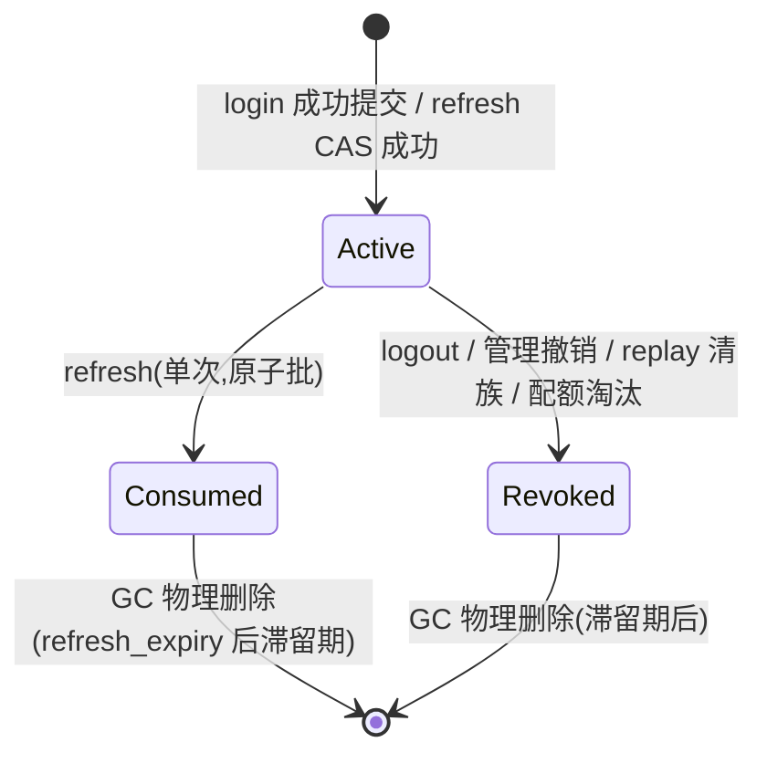

# ACL 安全加固设计:身份代际、会话状态机与多实例一致性

- 状态:草案(2026-11-16)
- 日期:2026-11-16
- 范围:`crates/acts`(acl trait、store 集合层)、`crates/acts-acl`、`plugins/acts-plugin-web|grpc|nats`、`crates/acts-server`(lease/错误映射)
- 关联:《ACTS 深度审计报告·第五卷 A》(输入,下称"审计")、`design/assignment.md`(承办人/候选人)、`design/caps.md`

## 1. 背景与目标

审计的 11 项发现已逐条对照代码确认(基线 `fix/sec@a0c3ef24`,`acts-acl` 13/13 测试通过,
即审计描述的是当前已发布行为)。其中 3 项比审计更严重:

| 审计编号 | 裁定 | 更严重之处 |
| --- | --- | --- |
| ACL-IDENTITY-01 | 确认 | — |
| ACL-PASSWORD-01 | 确认 | 盐仅 32 bit(`random_id(8)` = 8 个 hex 字符),低于一切 KDF 盐建议 |
| ACL-BOOTSTRAP-01 | 确认 | `create` 是盲 upsert,双实例竞态静默覆盖 admin 行,先到者打印的密码随即失效 |
| ACL-SESSION-01 | 确认 | 单实例并发即成倍复制:`refresh` 两次 `let _ = self.revoke(..)` 连撤销结果都不检查 |
| ACL-SESSION-02 | 确认,一处修正 | 修正:logout 会把 Store 失败如实上抛;吞错的是 refresh |
| ACL-SESSION-03 | 确认 | 更强:`mint()` 完全不读 users 表,同实例上被禁用/删除的用户仍可用 refresh 轮换满 7 天 |
| ACL-USER-01 | 确认 | 根因在 Store 层:`DbCollection::update == create == 盲覆盖`,无 CAS |
| ACL-MULTI-01 | 确认 | — |
| ACL-LOGIN-01 | 确认 | — |
| ACL-SESSION-04 | 确认 | — |
| ACL-AUTH-01 | 确认 | 三个 transport 一致;`Err→401` 分支对 `UserAcl` 不可达 |

审计未覆盖、本设计一并处理的三个事实:

1. `del_user` 本地缓存先删、Store 后删、会话逐条 `?` 撤销——一次 delete 失败即留下
   Store 内"活用户 + 孤儿会话行",重启即复活(§3.4 复活链的最短路径)。
2. `LoginTokens` 派生 `Debug` 且含明文双 token(`crates/acts/src/acl.rs:182-194`)。
3. 密码盐 32 bit(见上表)。

版本策略:**0.x 不迁移**(§14)。legacy 密码格式与旧 schema 行不做任何兼容,直接删除。

### 目标不变量(审计 §1 全部采纳)

- 主体身份不可复用(同名重建 = 新安全主体);
- 安全版本单调(禁用/改密/删除/强制退出即时失效既有会话,不依赖遍历删除);
- Refresh 单次消费(原子状态转换);
- 撤销先成为持久事实,再动缓存;
- 多实例接受窗口有上限,缓存过期且 Store 不可用时 fail closed;
- 密码抗离线破解(Argon2id);
- 认证入口有资源预算(KDF 并发、限流、会话配额)。

### 非目标

- 对象级 Process/Task/Message/Model 授权(审计第五卷 B);
- 引入外部依赖服务(Redis 等);失效广播只用已有 NATS 依赖,可选;
- MFA、密码策略复杂度规则、SSO/OIDC;
- 不改 `acl:login/refresh/logout/setuser/deluser/users/getuser` 的动作面(入参出参兼容)。

## 2. 术语与现状行号对照

审计基于 `acts-develop`,本设计行号基于 `fix/sec@a0c3ef24`:

| 审计引用 | 当前位置 | 内容 |
| --- | --- | --- |
| 80-106 | `crates/acts-acl/src/lib.rs:82-90` | `AclUser`(id 注释"username; doubles as the subject") |
| 164-179 | `lib.rs:164-181` | `AclSession`(行键 = access hash) |
| 258-264 | `lib.rs:229-236` | `UserAcl` 三个进程内 HashMap |
| 273-318 | `lib.rs:275-318` | `mint()`(无 enabled/存在性检查) |
| 321-336 | `lib.rs:322-339` | `revoke()`(先本地后 Store) |
| 339-357 | `lib.rs:341-358` | `session_principal()`(按用户名查缓存) |
| 383-432 | `lib.rs:369-438` | `load()`(全量物化 + bootstrap 打印密码 `409-421`) |
| 440-470 | `lib.rs:440-509` | `authenticate`(匿名并流)/`login`/`refresh` |
| 539-606 | `lib.rs:524-608` | `set_user`(整对象克隆覆盖) |
| 610-640 | `lib.rs:610-637` | `del_user`(缓存先删、逐条撤销) |
| 689-735 | `lib.rs:696-719` | `admin_row`/`salted`/`verify_password` |
| (审计未引) | `crates/acts/src/acl.rs:713-718` | trait 契约明文规定"缺失/未知/过期 token → anonymous" |
| (审计未引) | `crates/acts/src/store/mod.rs:196-233,438-455` | `StoreBatchOp`/`StoreGuard`/`KvStore::batch(guards)` |
| (审计未引) | `crates/acts/src/store/collection.rs:1063-1090` | `create == update`(盲 upsert)的官方注释 |
| (审计未引) | `crates/acts/src/store/lease.rs:1-46` | 独占库租约与 `FencedStore` |
| (审计未引) | `crates/acts-server/src/lib.rs:638-769` | server 层 lease 接线 |

术语沿用审计:`subject_id`(不可复用主体代际)、`security_version`(主体安全代际)、
`document_revision`(行级乐观并发)、`family_id`(refresh 世系)。

## 3. 可依赖的既有原语(关键事实)

审计假设需要新建"事务或同等原子 Guarded Batch"。仓库里已经有,审计未点透:

1. **`KvStore::batch(ops, guards)` 带条件写**。`StoreGuard{key, expected: Option<bytes>}`
   要求 key 在提交时刻精确持有 `expected` 字节(`None` = 必须不存在)
   (`store/mod.rs:203-233`)。六个后端全部原生实现:memory(`store/memory.rs:122`)、
   sled(`sled.rs:291`)、sqlite(`sqlite.rs:294-340`,`BEGIN IMMEDIATE` 事务内先验
   guard,跨连接正确)、postgres(`postgres.rs:191`)、rocksdb(`rocksdb.rs:411`)、
   shard(`shard.rs:1007`)。`acts-store/tests/{sqlite,postgres,rocksdb,shard}.rs`
   已有 guard 用例。默认实现对带 guard 的批返回错误(`store/mod.rs:438-455`),
   即"不支持的方言显式失败",不会静默退化。
2. **独占库租约**。`DbLease`/`FencedStore`/`LeaseKeeper`(`store/lease.rs`)用同一
   guard 原语实现"一库一活实例 + 围栏令牌",acts-server 已接线
   (`acts-server/src/lib.rs:638-769`)。多实例问题因此分两种部署模式(§10)。
3. **schema 版本钩子**。`DbCollectionIden::version()/upcast()` 已存在(v0 现状,拒绝
   其他版本)——0.x 直接升 1,旧行 fail closed(§14)。
4. **`Query`** 支持等值 filter + `order_by` + `offset/limit`(`store/query.rs:8-28`),
   配额淘汰与 GC 分页够用。

**缺口只有一个**:guard 原语停在 `KvStore` 层,`DbCollection` 的方法(`create`/`update`/
`delete`)没有把它暴露给集合调用方。所以 P0 只是"向上透三个方法",不需要动任何后端。

## 4. P0:集合层条件写

```rust
impl<DATA> DbCollection<DATA> {
    /// 插入,绝不覆盖:仅当 id 不存在时写入。false = 已存在,未写入。
    async fn create(&self, data: &Self::Item) -> Result<bool>;

    /// 覆盖写(update-or-insert):替换行并重建其索引行。
    async fn upsert(&self, data: &Self::Item) -> Result<bool>;

    /// CAS:仅当 id 当前精确持有 `expected` 的存储字节时写入。false = 冲突。
    async fn update_guarded(&self, data: &Self::Item, expected: &Self::Item) -> Result<bool>;
}
```

`create` 即 insert-only(取代早期的 `create_if_absent`);`update` 更名为 `upsert`。
不提供跨文档原子批(早期草案的 `write_batch_guarded` 已删):`KvStore::batch` 的
guard 能力仍在该层,ACL 需要的多步语义按"CAS 定序 + 新 id 插入"局部实现(§8)。

实现全部是既有件组装:`lock_docs` 拿文档锁(进程内)→ 读现值组 guard →
一次 `kv.batch(&ops, &guards)`。跨实例正确性由后端的原子批保证(sqlite/postgres 是
真事务;sled/rocksdb/memory 单进程本来就是单写者)。

**guard 用整行字节比较,不引入独立 revision 列做判定**:行内仍存
`document_revision`(诊断、审计、指标用),但并发正确性不依赖它——整行任何字段被
并发改动,expected 字节即失配。这与引擎其他 guard 用法(lease 行)一致,且避免了
"revision 字段自身被并发写"的自举问题。

引擎既有写路径的语义迁移:依赖覆盖写的地方(publish、`upsert_proc`、交付行状态
重置、触发器滚动)改为 `upsert`;find-then-create 的插入分支保持 `create`(现在
天然防竞态);`delete_all` 逐行提交的既有语义保留(GC 依赖它)。

## 5. 目标数据模型(schema v1)

行键选择:**`AclUser` 行键仍是用户名**(稳定业务键),**`AclSession` 行键仍是
access hash**(认证热路径 O(1) 点读,零新索引)。新增字段直接进 v1 schema(§14,0.x 不迁移)。

```rust
pub struct AclUser {
    pub id: String,                  // 用户名,行键不变
    pub subject_id: String,          // 128 bit 随机 hex(复用 random_id(16),不引 uuid 依赖)
    pub enabled: bool,
    pub security_version: u64,       // 禁用/删除/改密/强制退出 +1
    pub document_revision: u64,      // 每次成功 guard 写 +1(诊断用)
    pub passwords: Vec<PasswordCredential>,
    pub max_sessions: Option<u32>,   // None = 全局默认
    pub allow: Vec<String>, pub deny: Vec<String>,
    pub patterns: Vec<String>, pub snapshot: String,
    pub create_time: i64, pub update_time: i64, pub timestamp: i64, pub v: i32,
}

pub struct PasswordCredential {
    pub phc: String,                 // Argon2id PHC 串(唯一格式,§6)
    pub created_at: i64,
}

pub struct AclSession {
    pub id: String,                  // sha256(access token),行键不变
    pub session_id: String,          // 128 bit 随机 hex
    pub family_id: String,           // 登录代 → 首个 session_id;refresh 继承
    pub parent_session_id: Option<String>,
    pub user: String,
    pub subject_id: String,          // 签发时刻快照
    pub security_version: u64,       // 签发时刻快照
    pub refresh: String,             // sha256(refresh token)(新等值索引)
    pub access_expiry: i64,
    pub refresh_expiry: i64,
    pub state: SessionState,
    pub revision: u64,               // 行级诊断 revision
    pub create_time: i64, pub update_time: i64, pub timestamp: i64, pub v: i32,
}

#[derive(Serialize, Deserialize)]
#[serde(tag = "kind", content = "at")]
pub enum SessionState {
    Active,
    Consumed { at: i64, successor: String },   // successor = 新 session_id
    Revoked { at: i64, reason: String },       // logout / admin / replay / quota_evicted / migration_orphan
}

pub struct AclTombstone {            // 新集合 acl_tombstones,行键 = subject_id
    pub id: String,                  // subject_id
    pub name: String,                // 同名重建检测(等值索引)
    pub last_security_version: u64,
    pub deleted_at: i64,
}
```

索引声明变更(`indexed_fields`/`ordered_index_fields`):

- `AclSession`:`+ "refresh"`(refresh 等值查)、`+ "user"`、`+ "state"`、
  ordered `+ "refresh_expiry"`(GC 分页)。
- `AclTombstone`:`+ "name"`。
- **索引演进没有自动重建机制**(索引行由写入路径派生):加索引字段 = 升
  `version` + 清库重建,0.x 期间固定约定(§14)。

Secret 纪律:

- `LoginTokens` 手写 `Debug`,只输出 `at_xxxxxx…(len=35)` 形式(修复
  `acl.rs:182-194` 的明文派生);
- `AclUser`/`AclSession` 手写 `Debug`,passwords 只输出数量与算法标签;
- 不引入 `secrecy` 依赖:PHC 串本身无明文密码,泄漏面已在日志纪律层拦截(README
  明确禁止打印行体)。

## 6. 密码:Argon2id

- 依赖:`argon2 = "0.5"`(RustCrypto,PHC 经 `password-hash`),进
  `[workspace.dependencies]`;MIT/Apache 双许可,过 `cargo deny check`。
- 参数默认 **m=19456 KiB, t=2, p=1**(OWASP 起点低配,约 19 MiB/次);有预算部署
  README 推荐升到 64 MiB/t=3。env 覆盖:`ACTS_ARGON2_M_KIB` / `ACTS_ARGON2_T` /
  `ACTS_ARGON2_P`。参数落进 PHC 头,验证按存储参数走,改 env 只影响新哈希。
- 输入限制:原始密码 > 1 KiB 在 KDF 前拒绝(与"用户不存在/密码错"同一错误文案);
  不做 Unicode 归一化。
- **多密码上限 = 3**(`ACTS_ACL_MAX_PASSWORDS`):超限 `Config` 错,不自动淘汰
  ——轮换语义(add 新→rm 旧)与现有测试 `a_password_rotation_keeps_both_working`
  保持。上限封死"无限旧哈希扩大破解面"。
- 登录路径时间对齐:
  - 已知用户:按存储凭据逐个 `PasswordVerifier`(PHC 自带参数);
  - 未知用户:对编译期内置常量 dummy PHC 跑一次同样验证(生成方式:一次性随机
    32 字节密码 → Argon2id → 只留哈希,明文丢弃;哈希可公开,无安全含义);
  - 禁用用户:先验密码再拒绝(与"密码错"同一文案、同一耗时档)。
- 盐为 PHC 内建 128 bit;`salt$hash` 旧格式不做任何兼容,随 §14 一并删除。
- 比较一律走 `PasswordVerifier`,不手写字符串比较。

## 7. Bootstrap:默认密码 + 初始状态

**首次启动的上游语义(用户决策,2026-11-16)**:不设引导窗口、不打印秘密、也不
因缺省秘密而拒绝启动。空 `acl_users` 时:

**(1) env 直通(远程/无头部署推荐)**:`ACTS_ADMIN_PASSWORD` 非空白 → `load()` 直接
建 admin 行(PHC 存储),无初始状态标记。

**(2) 默认密码 + 初始状态(默认路径)**:无 env → admin 行以
`DEFAULT_ADMIN_PASSWORD`(`"admin"`,公开文档值,不是秘密)创建,并带
`must_change_password = true`:

- `AccessControl` 新增 `fn password_change_required(&self, subject) -> bool`
  (默认 `false`;`UserAcl` 读用户行缓存,O(1));
- 动作门禁(`export/actions.rs`,`check_action` 之前):主体处于初始状态时,仅放行
  `acl:setuser` 且 `name == principal.subject()` 且 `add_passwords` 非空;
  `acl:login/refresh/logout/whoami` 走各自凭据路径不受限;其余动作一律
  `Denied`,文案指引"先改密、再重登";
- 改密语义:`set_user` 在 `must_change_password` 且 add 非空时**清空旧凭据**再落
  新 PHC(默认密码必须消失),置 `must_change_password = false`,security_version
  照常 +1 —— 旧会话即死,**必须重新登录**(与用户决策逐字一致);
- 双实例首始:`create` 是 insert-only(CAS absent),败者读取现有行,不产生第二个
  admin 代际。

安全取舍:默认密码可被远程探测,但初始状态下该账号**零能力**(除改密/登出),
秘密不进日志的目标不受影响(默认值是公开文档值);远程部署建议 env 直通以跳过
初始状态。审计 §5.4 的"启动失败"不再采用(用户决策)。

## 8. 会话状态机与 Refresh 原子消费



Refresh(guard CAS 定序 + 后继插入;无跨文档批,安全性由 CAS 赢家唯一性保证):

```text
读旧行 row(access_hash = refresh 索引反查或本地缓存)
前置检查: state==Active, row.refresh==H(rt), refresh_expiry>now,
          用户行存在 && enabled && row.security_version==user.security_version
步骤1  update_guarded(old: state=Consumed{at, successor}, expected=old 整行字节)
       false → someone else consumed first → replay 路径(见下)
步骤2  create(successor: Active, family_id/parent/subject 快照, 全新 id)
       Err → 旧行已消费、后继未建:不返回 token,要求重登录(绝不产生双后继)
成功  → 返回明文 token(明文在两步前生成,两步都成功才交出)
Err(store) → **不返回 token**,错误上抛;客户端携旧 refresh 重试,若首次已提交
     则命中 replay → 清族 + 要求重登录。
     取舍(相对审计 6.7 的"可恢复 successor"):不缓存待决明文 token,选择 fail-safe
     ——宁可一次网络抖动导致整族登出,绝不产生双后继。
```

Replay 策略(默认开,`ACTS_ACL_REPLAY_REVOKES_FAMILY`):

- 计数 `acts_acl_refresh_replay_total`(结构化日志字段,§20);
- 遍历 `family_id` 等值匹配的 Active 行,逐行 guard CAS → `Revoked{reason:"replay"}`;
  逐行非原子,残余窗口 = 攻击者在清族进行中用另一活行换新——可接受:目标本就是
  全家失效;
- 对外统一 `Unauthenticated`,不泄露 successor 信息。

Login 配额:

- `max_sessions`(用户覆盖,默认 10;admin 建议更低)对 `state==Active` 计数
  (等值 filter user,内存过滤状态,order create_time asc);
- 超限:逐行 CAS 淘汰最老 Active(→ `Revoked{quota_evicted}`)后插入新行;
- 计数与插入跨实例非原子 → 允许 ε 超额(≤ 并发登录数),不做 per-user 锁;
  全局行数硬上限(`ACTS_ACL_MAX_SESSIONS`,默认无限)只拒绝新登录并告警。

Logout:CAS `Active → Revoked{reason:"logout"}`;已
Consumed/Revoked/不存在 → `Ok(false)`(幂等,不算错);Store 失败如实上抛。
顺序固定:**Store 先、缓存后**——`revoke()` 的"本地先删"退役,物理 `delete` 只归 GC。

## 9. security_version 与身份代际

递增操作(用户行 guard 写内一并完成,`document_revision` 同步 +1):

| 操作 | security_version | 其他 |
| --- | --- | --- |
| 禁用/启用 | +1 | — |
| 增/删密码 | +1 | — |
| `UserSpec.force_logout = Some(true)`(新字段) | +1 | O(1),不遍历会话 |
| 删除用户 | 终止(行消失) | tombstone 先写 + 行删除,见下 |
| 高风险 allow 变更 | 按策略(默认不升) | 普通收紧靠 document_revision 刷新 Principal 缓存(§10) |

`del_user`(两步,无跨文档批):

```text
步骤1 create(tombstone{subject_id, name, last_security_version, deleted_at})
      失败只丢历史,继续
步骤2 delete(user 行) —— 安全事实;set_user 是 CAS,两步线性化:
      并发 patch 要么先落(随之被删),要么 guard 失配 → Conflict
```

- 用户行消失后,其全部会话因 `subject_id` 无法匹配(用户已不存在)而全死——
  **不逐条遍历撤销**,`del_user` 现在的 `for hash in dead { revoke }` 循环删除;
- 同名重建生成新 `subject_id`,旧会话/旧 refresh 永久失配(审计 3.9 验收全过);
- 普通权限变更(`set_user` 不触密码/enabled):Principal 编译缓存按
  `document_revision` 键控,收紧即时生效,不强制登出(审计 21.2 采纳)。

`set_user` 重写:读 **Store** 行(`find_opt`,不再以本地缓存为事实源)→ 应用
patch → `update_guarded`。冲突返回 `ActError::Conflict`(error.rs 新变体,
web→409、gRPC→`Status::aborted`、NATS→错误回包),调用方重读重试;服务器不做
安全 patch 的自动合并。

## 10. 多实例一致性

两种部署模式,正确性策略不同:

**模式 A:独占库租约(acts-server 推荐)**。`FencedStore` 围栏使每条持久写都带
guard,过期写者被 `LeaseLost` 拒绝。ACL 写分叉消失;接管者 `load()` 全量重建缓存。
残余问题只剩接管窗口内的读缓存,由 TTL 兜底。ACL 不需要额外代码,**只需确认
`UserAcl` 的写都走 `Store` 句柄且 `FencedStore` 在其下**(现状成立:所有写经
`store.collection(...)`;P2 前唯一例外是 `del_user` 的本地先删,重写后消除)。

**模式 B:并发多实例(sqlite/postgres 共库;共享盘 sled/rocksdb 不构成并发部署)**。
两级缓存 + 有界窗口:

| 缓存 | 键 | TTL(默认) | 失效 |
| --- | --- | --- | --- |
| SecurityHeader:`{subject_id, enabled, security_version, document_revision}` | subject_id | 2 s(`ACTS_ACL_HEADER_TTL_MS`) | TTL / 广播 |
| Session 行(写穿) | access_hash | 5 s(`ACTS_ACL_SESSION_TTL_MS`) | 本实例写操作即时;其他实例靠 TTL |

访问路径稳态零 Store IO(token → 本地 session map → header 缓存 → 比对)。
本地 miss(实例从未见过该 token)回源 `find_opt(access_hash)`。

Fail-closed 规则:header 缓存过期 **且** Store 读失败 → 拒绝(Unauthenticated);
缓存新鲜 → 放行(与审计 16.2 一致)。`ACTS_ACL_FAIL_CLOSED=strict` 则每次访问都回源。
写操作(login/refresh/setuser)一律实时 Store,无缓存豁免。

广播(可选,P3):NATS topic `acts.acl.invalidate`,消息只含
`{subject_id, document_revision, security_version}`,命中即删缓存项。可丢,不作
正确性依赖;未配置 = 纯 TTL 收敛。

收敛 SLA:

| 操作 | 模式 A | 模式 B(无广播) | 模式 B(有广播) |
| --- | --- | --- | --- |
| 禁用/改密后旧 access 失效 | ≤ header TTL 2 s | ≤ 2 s | ≈0 |
| logout 后其他实例拒绝 | ≤ session TTL 5 s | ≤ 5 s | ≈0 |
| 删除后同名重建隔离 | 即时(subject 失配) | 即时 | 即时 |

时钟:沿用 `now_millis()`(UTC 墙钟);共享库实例须时钟一致——`store/lease.rs`
已声明同一前提,不新增要求。

## 11. 认证三态

trait 增方法,默认实现向后兼容(外部 `AccessControl` 实现者不破):

```rust
pub enum AuthenticationResult {
    MissingCredentials,          // 无 token
    Authenticated(Principal),
    InvalidCredentials,          // 未知/过期/已消费/被撤销/主体失配
}

pub trait AccessControl {
    fn resolve(&self, token: Option<&str>) -> AuthenticationResult;
    // 旧 authenticate 保留,默认:resolve → Invalid/Missing 折叠为 Ok(anonymous)
}
```

`UserAcl` 精确实现三态;transport 切到 `resolve`。同批新增
`fn password_change_required(&self, subject) -> bool`(默认 `false`),供初始状态门禁判定(§7):

- web(`auth.rs`):`Missing` → 现行匿名策略路径;`Invalid` → 401(现有 401 分支
  从此可达);`Authenticated` → 继续;
- gRPC(`lib.rs:187-190`):`Invalid` → `Status::unauthenticated`;`Missing` → 匿名继续;
- NATS(`lib.rs:312-314`):`Invalid` → 拒绝回包(带 ack/seq);`Missing` → 匿名继续。

错误文案不区分过期/未知/伪造/主体失配;指标区分(§20)。

## 12. 登录预算

进入 KDF 前的顺序闸门(login/refresh 之外的入口不消耗密码预算):

1. 每 IP 限速:仅 web 层 tower 中间件,进程内计数(集群级交给网关——envoy/nginx
   已是部署文档既有项;NATS/gRPC 入口由核心闸门覆盖,IP 维度天然缺失,如实声明);
2. 每规范化用户名失败退避:进程内 LRU(10k 容量)计数,5 次失败后指数退避
   1/2/4/…/900 s(`ACTS_ACL_LOGIN_MAX_FAILURES`、`ACTS_ACL_LOGIN_BACKOFF_MAX_SECS`);
   成功登录清零;
3. 每主体成功登录速率:令牌桶 10/min burst 5(防会话膨胀第二道闸,配额之外);
4. 全局 KDF 信号量:`Arc<Semaphore>`,默认 8(`ACTS_ACL_KDF_CONCURRENCY`)。
   默认参数下峰值内存 ≈ 8 × 19 MiB ≈ 152 MiB;调 64 MiB 参数时按此公式重估。
5. dummy/real Argon2id(§6)→ 统一错误 → 配额 → mint。

预算全部在 `acts-acl` 核心:NATS/gRPC 的 `acl:login` 与 HTTP 共享同一用户名退避与
KDF 信号量。

## 13. GC 与容量

- `load()` 末尾 `tokio::spawn` GC 循环(`AtomicBool` 防重复 spawn;随进程/runtime
  结束消亡,无独立 shutdown 钩子——如实标注);
- 每 60 s(±20% jitter,`ACTS_ACL_GC_INTERVAL_SECS`)分页扫描
  `refresh_expiry < now - 1h`(`ACTS_ACL_GC_RETENTION_SECS`),每页 500 条按
  refresh_expiry 有序索引推进,物理 `delete`;
- 跨实例安全:删除按行键幂等(delete 返回 false 无害);不 CAS(过期行本就该死);
- 启动加载改造:`load()` 不再 `query_all` 全量物化——按 `create_time` 有序、
  offset 分页遍历,**只物化 Active 且未过期行**,过期行跳过留给 GC 首轮;
- 容量指标:活跃行数、GC backlog(本轮未清完)、每主体会话数分布(§20)。

## 14. 版本策略:0.x 不迁移

项目仍处 0.x,不携带任何迁移路径(用户决策,2026-11-16):

- `version()` 直接置 1,`upcast` 只接受 v1;读到 v0 行(旧 0.x 写入)即
  "unsupported acl user version" 启动失败——fail closed,错误文案指明清空
  `acl_users`/`acl_sessions` 两个集合(或数据目录)后重启;
- **无 legacy 密码格式**:`salted()`/`verify_password()`(lib.rs:707-719)与
  `salt$hash` 格式整体删除,存储与验证只有 Argon2id PHC 一条路(§6);
- **无字段回填**:`subject_id`/`security_version`/`document_revision` 在创建路径
  (`admin_row`、`set_user` 新建分支)直接生成,不存在迁移派生态;
- 新增索引字段(refresh/user/state/refresh_expiry/name)在全新集合上无重建问题;
  未来再加索引字段仍须升 version 并同样清库——0.x 期间的固定约定。

随本次删除的旧代码:

| 位置 | 内容 | 去向 |
| --- | --- | --- |
| `lib.rs:707-719` | `salted()`/`verify_password()` 快速哈希 | 删除 |
| `lib.rs:322-339` | `revoke()` 本地先删路径 | 换成 CAS 状态写(§8) |
| `lib.rs:369-438` 的启动过期清理 | load 期内联删过期行 | 归 GC 循环(§13) |
| `lib.rs:628-637` | `del_user` 逐条会话遍历撤销 | 版本失配即死,无遍历(§9) |

审计第 17 节(双读双写、Minimum Compatible Version、孤儿迁移)整体不适用。

## 15. 五个流程(改造后)

```text
登录    归一化 → IP/退避/速率闸 → KDF 信号量 → 读用户行(缓存) → dummy/real Argon2id
        → enabled → 配额(超限逐行淘汰) → create(新 Active 行) → 写穿缓存 → 交 token
访问    sha256 → 本地 session 缓存(miss 回源) → Active + access_expiry
        → header 缓存(TTL/strict 回源) → subject_id/security_version 比对
        → document_revision 命中则复用 Principal → Authenticated / Invalid / Missing
刷新    见 §8(CAS 消费 + 新行,单原子批;replay 清族)
登出    CAS Active→Revoked(幂等) → 缓存逐出 → 广播(可选)
禁用/改密/删除  set_user patch(guard CAS) → security_version+1 → 缓存失活(TTL/广播)
        → 旧会话零遍历即死 → GC 异步物理清理
```

## 16. 测试矩阵与验收

既有 13 个测试全部保留(语义不变的断言不动;`an_unknown_or_absent_token_is_anonymous`
拆为三态)。新增用例(审计 §18 落地):

| 用例 | 类型 | 基础设施 |
| --- | --- | --- |
| 64 路并发同 refresh,成功恰为 1 | 单实例 tokio | memory store |
| 双实例共享 sqlite 文件:A 禁用 → B 在 TTL 内拒绝;A logout → B ≤5s 拒绝;A 改密 → B 不能再签发 | 集成 | `acts-store` sqlite(tempfile),`--features sqlite` |
| 删除 + 同名重建:旧 access/refresh 全拒;重启后旧会话不复活 | 集成 | sqlite |
| refresh 消费批注入 Store 错误(自定义 `KvStore` 包装,failing on batch)→ 无双后继;重试命中 replay 清族 | 单实例 | guard-counting 测试 KV(仿 `scheduler/shell/tests` 的 `GuardCountingKv`) |
| 并发 set_user:CAS 冲突返回错误且不覆盖对方改动(删密码 vs 改 allow) | 单实例 | memory |
| 损坏 PHC → 受控错误;>1KiB → KDF 前拒绝;已知/未知用户耗时分布无明显差(宽松断言) | 单实例 | memory |
| bootstrap:env 直通;**默认密码初始状态**——admin/admin 可登录、门禁拒绝非改密动作、改密后默认密码消失且旧会话失效、重登成功;双实例首始仅一个 admin 代际(create 撞键) | 单实例+集成 | memory / web 测试 |
| 旧版本(v0)行 → 启动失败且错误指向清库;清库后 bootstrap 正常(upcast 单测) | 单元 | memory |
| 配额:超限淘汰最老;GC 分页清理过期;百万行启动不全量物化(10 万行压测近似) | 集成 | sqlite |
| 三态:同一路由无 token 200 / 假 token 401 | 集成 | web 插件 axum 测试 |

CI 无 postgres/NATS 时:双实例语义用 sqlite 覆盖(文件锁即跨进程真并发);postgres
用例沿用现有 `tests/postgres.rs` 的服务约定,缺席时明示未跑(仓库规则)。

## 17. 配置面

| 项 | 默认 | 载体 |
| --- | --- | --- |
| Argon2 m/t/p | 19456 KiB / 2 / 1 | `ACTS_ARGON2_M_KIB` / `_T` / `_P` |
| 密码数上限 / 长度上限 | 3 / 1 KiB(固定) | `ACTS_ACL_MAX_PASSWORDS` |
| KDF 全局并发 | 8 | `ACTS_ACL_KDF_CONCURRENCY` |
| 用户名失败退避 | 5 次,1 s→900 s | `ACTS_ACL_LOGIN_MAX_FAILURES` / `_BACKOFF_MAX_SECS` |
| 每主体成功速率 | 10/min burst 5 | 常量(暂不配) |
| header / session 缓存 TTL | 2000 / 5000 ms | `ACTS_ACL_HEADER_TTL_MS` / `ACTS_ACL_SESSION_TTL_MS` |
| fail-closed | 默认(过期+Store 失败=拒) | `ACTS_ACL_FAIL_CLOSED=strict` 全回源 |
| 每用户会话上限 / 全局上限 | 10 / 无(告警) | `UserSpec.max_sessions` / `ACTS_ACL_MAX_SESSIONS` |
| GC 间隔 / 滞留 / 批量 | 60 s / 1 h / 500 | `ACTS_ACL_GC_INTERVAL_SECS` / `_RETENTION_SECS` |
| replay 清族 | 开 | `ACTS_ACL_REPLAY_REVOKES_FAMILY` |
| bootstrap 首密码 | 默认密码 + 初始状态 | `ACTS_ADMIN_PASSWORD` 直通跳过初始状态 |
| admin 密码 env | — | `ACTS_ADMIN_PASSWORD`(不变) |

## 18. 分期与依赖

| 阶段 | 内容 | 依赖 | schema |
| --- | --- | --- | --- |
| P0 | 集合层条件写(create=插入 / upsert / update_guarded) | 无 | 无 |
| P1 | 止血:bootstrap(env 直通 + 默认密码初始状态)、Argon2id + dummy KDF(PHC 直接存入 passwords 列)、登录预算、`LoginTokens` Debug 遮蔽 | P0(首始 create 撞键防护) | 无 |
| P2 | v1 schema(直接建新行,不迁移)、状态机、refresh(CAS 定序 + 后继插入)、security_version、tombstone、set_user CAS、del_user(tombstone+delete)、三态 auth(`ActError::Conflict` 新变体 + transport 映射) | P0 | v1 |
| P3 | 配额、GC、启动加载改造、缓存 TTL + fail-closed、NATS 广播(可选) | P2(v1 索引) | v1 |
| P4 | 指标字段、README/CHANGELOG、dev 换密文件清理(可选) | P2 | — |

关键路径:P0 → P2。P1 不依赖 schema,可先行合入单独提交。

## 19. 风险与取舍

| 风险/取舍 | 处置 |
| --- | --- |
| guard 是字节级比较,依赖序列化稳定性 | 同一二进制的 struct serde 序列化字段序确定;expected 一律来自本次刚读出的存储字节 |
| refresh 提交结果未知 → 整族登出 | 可用性换安全,已在 §8 声明;审计 6.7 的可恢复方案(密文暂存)明确不做 |
| 默认密码可被远程探测 | 初始状态使账号零能力(仅改密/登出/凭据自身动作);改密即清除默认凭据并强制重登;远程部署文档明示用 env 直通 |
| 配额 ε 超额(跨实例计数竞态) | 上界 = 并发登录数;依赖精确上界则需 per-user 原子计数行,收益不足 |
| 模式 B 无广播 2 s/5 s 窗口 | 审计 10.8 接受有界窗口;广播可选关闭 |
| Argon2id 登录延迟 ~50–150 ms/核 | 信号量限吞吐;预算表进 README |
| 新依赖 argon2(+password-hash/blake2/subtle 传递) | workspace 单版本策略,`cargo deny check bans` 过门;MSRV 1.91 满足 |
| `AccessControl` 外部实现者的兼容 | `resolve` 带默认实现,旧 `authenticate` 语义不变 |
| 加索引字段必须升 version + 清库 | 0.x 约定已声明(§14);1.0 前不构成约束 |
| GC 任务无独立 shutdown 钩子 | 随 runtime 结束消亡;循环内 sleep,无泄漏面 |
| sled/rocksdb/共享盘的"多实例" | 明确不支持:sled/rocksdb 为单进程后端;并发共享库仅 sqlite/postgres(+shard 包装) |

## 20. 指标

仓库当前无 metrics 管线(仅 `sysinfo` 系统指标),本设计先以 **tracing 结构化字段**
落地(字段名即审计 §19 的指标名),导出端点留待 P4 评估:

```text
acts_acl_login_total{result=ok|invalid|rate_limited|quota}
acts_acl_refresh_total{result=ok|replay|conflict|error}
acts_acl_refresh_replay_total
acts_acl_auth_total{missing|invalid|ok}
acts_acl_kdf_inflight / acts_acl_kdf_duration_seconds
acts_acl_sessions_active / acts_acl_sessions_gc_backlog
acts_acl_security_version_mismatch_total
acts_acl_cache_stale_total / acts_acl_fail_closed_total
```

告警项沿用审计 §19(replay 突增、fail-closed 突增、KDF 饱和、GC backlog、
单主体会话逼近上限)。

## 21. 结论

审计的全部结构判断成立。仓库比审计假设多两件关键资产:跨后端的
`StoreGuard` 原子条件写,和已接线的独占库租约。因此改造主线收敛为:

```text
P0  把已有 guard 原语透到集合层
P1  凭据止血(不动 schema)
P2  subject_id + security_version + 持久会话状态机 + 原子 refresh(v1 schema,0.x 不迁移)
P3  有界缓存 + 配额 + GC + fail-closed
```

完成后:用户名回归可读业务名,缓存回归纯性能层,物理删除回归纯回收——
安全事实只由 Store 里的 subject 代际、安全版本和会话状态承载。
