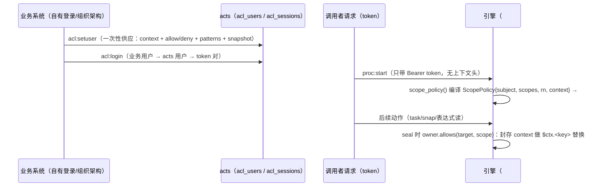
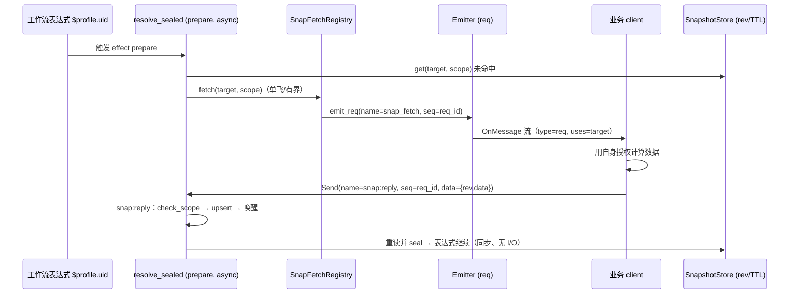

# 业务授权上下文（scope/context）与 Snapshot 拉取（req/reply）设计

- 状态：定稿（设计 + 评估），计划见 `doc/plan/2026-11-20-scope-context-snap-fetch.md`
- 日期：2026-11-20
- 范围：`crates/acts`（acl、snapshot、scheduler/shell/context、event）、`crates/acts-proto`、
  `crates/acts-acl`、`plugins/*`、`examples/`
- 关联：第五卷 B 审计（AUTHZ-01/05/07/09）；`doc/design/owner-expr.md`（业务数据由业务系统解析的同构先例）

## 1. 背景与目标

业务系统有独立的登录与授权。两项需求：

1. **授权上下文下传**：业务方把 tenant、unit、department 等授权范围与能力传入 acts 的
   ACL；流程启动后实例封存这份 scope/context，作为此后 ACL 访问的授权依据。
2. **Snapshot 拉取**：修改现有 snap 机制，`acts-proto` 增加服务端到 client 的 req/reply
   支持。业务系统以注册 client 的身份提供 `$profile`、`$security` 这类数据；流程表达式
   读取时按流程携带的 scope/context 查 snap 缓存，缺失则向注册的 client 发 req/reply
   取数，并写入 snap 缓存。

### 1.1 目标

1. 业务上下文只从 ACL 用户策略进入引擎，流程实例把它封存进 `#owner`（现状机制），
   子流程自动继承，每次 seal 重检。
2. 模式（scope/rn pattern）可用 `$subject` 与 `$ctx.<key>` 两类替换词表达
   `tenant/unit/department` 维度。
3. 表达式读 `$<target>.<key>`：缓存命中走本地读；未命中且目标开启了 fetch，则在
   effect prepare 的异步段内向业务 client 发 req、等一次有界应答，回填缓存后再 seal。
   表达式求值本身保持同步、无 I/O。
4. req/reply 复用现有 `acts-proto` 字段（`Send`/`OnMessage`、seq 回显关联），不加字段；
   内核新增 `snap:reply` action，授权与 `snap:upsert` 同一把尺子。
5. 不新增任何"从流程变量或 start options 注入授权"的通道。
6. snapshot 目标注册唯一入口是变量注册（`pack:publish` 元数据 = 变量名 + 配置参数
   + 提供者包名）；`add_snapshot` 等部署侧注册 API 移除，推模式保持 upsert
   自动注册且恒为纯推。

### 1.2 非目标

- 不做多租户 Store 索引与列表下推过滤（第五卷 B AUTHZ-01 的 Store 层改造另行立项）。
- 不把授权证明（`AuthorizationProof`）做成跨请求 Token。
- 不在引擎内核实现业务目录：上下文的**语义**（tenant 是什么、unit 属于谁）由业务系统
  解释，acts 只做模式匹配与封存，与 `owner-expr.md` 的分工一致。
- 不提供负缓存（negative cache）与拉取重试退避（见 §7 开放问题）。

## 2. 现状与约束

### 2.1 ACL 与主体

- `Principal`（`crates/acts/src/acl.rs`）持有 allow/deny（命令 glob + `@catalog`）、
  资源名 patterns（rn）、snapshot scopes（`target -> Vec<pattern>`，`$subject` 可参与）。
- `UserPolicy.snapshot: HashMap<String, Vec<String>>` 经 `acl:setuser` 管理；
  模式替换目前只有 `$subject`（`substitute`，acl.rs:1013-1016），scope 与 rn 两处都走它。
- deny 优先、默认拒绝；`Principal::check_scope(target, scope)` 是 `snap:*` 四个动作与
  seal 时共用的对象级检查。

### 2.2 流程封存的授权依据（已存在，本设计复用）

- 启动时把调用者权威封存进进程：`ProcessExecutor::start` 调
  `start_as_owner(mid, options, &self.principal.scope_policy())`（`process_executor.rs:44-49`），
  权威以 `consts::PROC_OWNER = "#owner"`（`consts.rs:51`，私有键）放入 start options，
  由 `Runtime::start` pop 出来（`runtime.rs:367-368`），既不进用户变量，也读不可读
  （伪造 `#owner` 的负向测试在 `env/tests.rs:363-370`、`export/executor.rs:361-382`）。
- `ScopePolicy { subject, all, scopes, rn, enforce_rn, workdir_root }`
  （acl.rs:243 起）序列化进聚合根变量（`shell/model.rs:687-693`），遗留行读取为
  `deny_all`（`shell/facts.rs:344-354`）。
- 子流程以 `ctx.proc.owner_scope()` 继承（`package/core/subflow.rs:95-97`）：子流程
  读不到比父流程更宽的数据。
- 每次.effect prepare 的 seal 都重检：`Context::resolve_sealed`
  （`shell/context.rs:287-353`）先解析 scope key（任务参数链拼 `/`），再
  `owner.allows(&name, &scope)`，不通过即 `ActError::Denied`，然后才 `store.get`。

**结论**：需求 1 的"实例记录 scope/context 并作为授权依据"骨架已在；缺的是
上下文词表（tenant/unit/dept）如何进入 `ScopePolicy`，而不是新的封存机制。

### 2.3 Snapshot 现状

- 目标在部署侧注册：`Engine::add_snapshot(name, options)`（engine.rs:112-115）与
  builder（engine.rs:389-395），`SnapshotOptions { policy, scope, on_missing, ttl_secs }`
  （`snapshot.rs:85-113`）。`scope` 是"任务参数名列表，值按 `/` 拼成 scope key"。
- 数据由外部系统**推**（`SnapshotManager::upsert(name, scope, rev, data)`，
  rev 单调守卫，乱序/重放回不滚），缓存仅内存，重启由消息总线重建。
- seal 缺失时按 `on_missing`（Skip/Error）处理；模块文档明确"resolve 不做网络 I/O，
  远端延迟与故障不进调度热路径"（`snapshot.rs` 模块头）。
- 表达式读法：`$<target>.<key>` —— `env/functions.rs:56-59` 先查用户变量，`85-89`
  `sealed_data` 读本任务（或祖先）的 sealed map（子覆盖父）。

### 2.4 消息通道与线协议现状

- 订阅键 `{subject}/{client_id}`（`ChannelOptions::subscription_id`，
  `export/channel.rs:47-56`），过滤为 type/state/uses/options 四组 glob，过滤器是
  自声明的；`Emitter::emit_message`（`event/emitter.rs:486-489`）→
  `DeliveryTargets::matching`（`event/targets.rs:50-56`）→ 按通道投递（ack 通道有
  delivery 行，可 ack/retry/clear/redo）。
- `acts-proto`：`Message { name, seq, ack?, data? }`；`OnMessage(MessageOptions)`
  服务端→client 流；`Send(Message) returns (Message)` client→服务端一元；
  `seq` 的既有约定就是"请求携带、应答回显"（`acts-proto/src/utils.rs`）。
- `Message::is_act()` 以 `uses.is_some() && type != "assignment"` 判定 act 语义
  （`event/message.rs:131-134`）：合成消息若带 `uses` 进普通消息面，会被消费方误当
  act 处理 —— 拉取请求必须绕开这条语义（见 §4.4）。

### 2.5 本设计触碰的不变量

| 不变量 | 现状出处 | 本设计 |
| --- | --- | --- |
| seal = 本地缓存读，无网络 I/O | `snapshot.rs` 模块头 | **弱化**：fetch 目标在 prepare 的异步段做一次有界拉取；表达式求值仍无 I/O（§5.1） |
| 授权只来自 ACL 用户策略，不来自流程变量 | `#owner` pop + 伪造测试 | 保持；context 只进 `UserPolicy`（§3.1） |
| 子流程不越过父流程 | `subflow.rs:95-97` | 保持；context 随 `owner_scope()` 自动继承 |
| deny 优先、默认拒绝 | `Principal::check` | 保持；`$ctx.<key>` 缺失时模式不匹配任何 scope（fail-closed，§3.3） |

## 3. 架构决策 A：业务授权上下文

### 3.1 上下文从哪里进入：只从 ACL 用户策略

| 备选 | 结论 | 理由 |
| --- | --- | --- |
| `acl:setuser` 增加 `context` 字段 | **采用** | 与 allow/deny/patterns/snapshot 同源、同生命周期、同审计；`acl:setuser` 本就是管理员门内的供应接口 |
| `proc:start` options 携带 context | 拒绝 | options 是调用者可控输入；引擎只会 pop 私有 `#owner`，接受任何客户端声明的上下文等于允许自我提权（伪造测试正是这条边界的回归锚点） |
| 每请求 Header 声明 context（受信 sidecar 签名） | 拒绝（暂缓） | 引入新的信任面与验证协议（第五卷 B AUTHZ-09），收益不抵复杂度；业务登录 → acts 用户策略的映射已够用 |

业务系统的登录与授权留在业务侧；acts 里的用户是该业务身份的**投影**：
`acl:setuser` 供应 allow/deny（能力）、patterns（可命名的 rn）、snapshot 模式
（可读的数据范围）与 context（组织维度词表）。上下文变化对已有会话不追溯 ——
会话里的 Principal 不变，运行中的流程仍用封存时的权威（这与第五卷 B 的
policy_revision 语义一致，也正是实例隔离想要的效果）。

### 3.2 数据模型

```rust
// acl.rs
pub struct UserPolicy {
    // … 现有字段不动
    /// 组织维度词表：tenant/unit/department 等。key: [a-z][a-z0-9_]{0,31}，
    /// value 非空、长度上限 128、条目上限 16；参与 $ctx.<key> 替换。
    #[serde(default)]
    pub context: BTreeMap<String, String>,
}
// SetUserPolicy 增加 context: Option<BTreeMap<String, String>>（None 不变更，同 snapshot 语义）

pub struct ScopePolicy {
    // … 现有字段不动
    /// 随 #owner 封存、被子流程继承的上下文副本
    #[serde(default)]
    pub context: BTreeMap<String, String>,
}
```

两个结构都加 `serde(default)`：acts-acl 落盘的旧行、聚合里旧流程行无需迁移，
读出即今日行为。

### 3.3 替换规则

`substitute(pattern, subject)`（acl.rs:1013-1016）扩展为
`substitute(pattern, subject, context)`：

- `$subject` → 主体名（不变）；
- `$ctx.<key>` → `context[key]`；
- **模式引用了不存在的 key → 该模式匹配任何值（fail-closed）**。拒绝"替换成空串"
  的写法：`""` 参与 glob 仍可能意外命中（如 `"" + "/*"`），空串替换不是安全的缺省。

scope 模式与 rn 模式都吃同一替换（两处今天都调 `substitute`）。示例：

```json
{ "user": "alice", "context": { "tenant": "t1", "unit": "u9" },
  "patterns": ["orders:$ctx.tenant:*"],
  "snapshot": { "profile": ["$ctx.tenant/$ctx.unit/*"],
                "security": ["$ctx.tenant/*"] } }
```

 alice 启动流程后，实例的 `#owner` 携带 `context = {tenant: t1, unit: u9}`；
seal 时 scope key `t1/u9/x` 命中 `profile` 的模式，`t2/u9` 不命中。`department`
等更多维度同法，词表是开放的（校验后的任意 key）。

### 3.4 封存与重检

无新机制：`Principal::scope_policy()` 编译时带上 context；`#owner` 序列化
`ScopePolicy`（含 context）；子流程 `start_as_owner(ctx.proc.owner_scope())`
原样继承；`resolve_sealed` 的 `owner.allows` 用封存副本里的 context 做替换 ——
策略后续变化不影响已启动实例读取范围（实例隔离），新实例拿新词表。

`acl:whoami`（`Principal::to_value`）回显 `context`：调用者可见自己的维度。

### 3.5 端到端传递链路

核心原则：**上下文不随请求传输，预先供应到 acts 用户策略；请求只带 token。**



供应一次（`UserSpec` JSON，catalog `write`；通道：CLI `acts auth user …`、gRPC
`Send{name:"acl:setuser"}`、NATS `acts.cmd`；Web 目前无 acl 路由，P1 视需要补）：

```json
{ "name": "alice",
  "context": { "tenant": "t1", "unit": "u9", "department": "d3" },
  "allow": ["@read", "@execute"],
  "patterns": ["orders:t1:*"],
  "snapshot": { "profile": ["$ctx.tenant/$ctx.unit/*"],
                "security": ["$ctx.tenant/*"] } }
```

生命周期语义：业务组织变化 → 重新 `acl:setuser` → 对新登录与新启动的实例生效；
在跑实例不追溯（封存副本，实例隔离）；需要立即生效走 `acl:disable_user`/
`acl:logout_user` 撤会话后重登。服务账号代理多个终端用户时，仍按终端用户映射
 acts 用户（一份 context 一份），否则上下文互相串。

## 4. 架构决策 B：Snapshot 拉取（fetch-on-miss + req/reply）

### 4.1 拉取发生在哪：effect prepare 的异步段，不在表达式求值

`resolve_sealed` 本就是 `async`（`context.rs:281-285`），且 effect 的
`resolve`/`run` 已经等待逐 act 的工作（包 `prepare_params`、IRQ 等 client 决策，
`shell/caps/effect.rs:267-330`）。在"缓存未命中"分支插入**有界**拉取：

```
owner.allows 通过 → store.get 未命中 → 目标开启 fetch？
  ├─ 否：维持现状（on_missing）
  └─ 是：SnapFetchRegistry.fetch(target, scope)（有界等待）
        ├─ 得到 (rev, data)：SnapshotManager::upsert（rev 守卫）→ 重读 → seal
        └─ 超时/无提供者：落回 on_missing（Skip/Error）
```

被否决的备选：把表达式求值做成 async（改 acts-expr 的每个求值点与重试语义）——
爆炸半径大且无收益：异步缝隙已经存在，就在 prepare。

### 4.2 目标注册：唯一入口是变量注册（包发布），`add_snapshot` 移除

注册即 `pack:publish`：包 id 是提供者身份（`acts.clientA.profile`），`options`
元数据同时给出变量名与配置参数。没有第二条注册路径 —— `Engine::add_snapshot`、
builder 的 snapshot 列表与 `SnapshotManager::register` 全部移除：

```json
{ "id": "acts.clientA.profile", "run_as": "irq", "name": "Profile",
  "options": {
    "var": "profile",
    "ttl_secs": 300,           // 缓存有效期；缺省不过期（现状默认）
    "timeout_ms": 3000,        // 单次拉取上界，钳位 [100, 30000]
    "on_missing": "skip",      // skip | error：拉取失败/无提供者时
    "scope": ["tenant", "unit"] // 缺省 = 封存上下文键（§4.6）
  } }
```

发布校验：`var` 满足 §3.2 词表规则；`run_as` 必须是 client 执行的 `irq`（func 型
没有可等的运行时实例）；同名 var 已注册时参数须逐项一致，不一致拒绝发布
（先到先得，改参数 = 下线旧包再发布）。

推模式不受影响：`SnapshotManager::upsert` 对未知 target 的自动注册保留
（snapshot.rs:319-331），自动注册永远 `fetch: None` —— **fetch 只能经
`pack:publish`（catalog `deploy`）打开；喂食者（`snap:upsert`，catalog `write`）
无法为一个陌生 target 打开拉取**。两个后果，都是接受的：

1. 纯推 target 不再能单独配置 TTL/`on_missing`/scope 参数，只能用默认值；
   需要定制的推送目标同样走变量注册（发布后数据照常推喂；未命中时的拉取因
   无提供者应答而按 `on_missing` 落地，行为退化为"推为主、拉为兜底"）。
2. 审计卷 5B §7.2 的"陌生 target 自动注册"关注点收窄：自动注册只能造出纯推
   target，造不出会外呼的 target。

`$profile`、`$security` 只是**开启了 fetch 的目标名**，表达式读法不变
（`env/functions.rs:85-89` 的 sealed 读）。scope key 默认从封存上下文拼出
（§4.6），显式 `scope` 参数名仍可用；是否可达由 `#owner` 的模式决定 ——
scope key 算到 `t2/*` 也只会得到 `Denied`，不会触发拉取。

### 4.3 SnapFetchRegistry：单飞 + 有界等待

Runtime 持有：

```rust
struct SnapFetchRegistry {
    /// (target, scope) -> 单飞槽
    pending: Mutex<HashMap<(String, String), FetchWaiter>>,
}
struct FetchWaiter {
    req_id: String,          // utils::create_seq()
    notify: tokio::sync::watch::Sender<Option<FetchedEntry>>, // 首个有效应答
}
```

- 首个调用者成为 leader：发请求事件（§4.4）、`timeout(timeout_ms)` 等待；
  并发的 prepare（同 run 的其他 act、其他 run 的同 scope）join 同一槽，
  不重复外呼（防惊群）。
- leader 超时：槽内所有等待者收到 `None`，槽移除；**v1 不重试**（下一次 prepare
  自然再发一次，等价于由调度节流的重试）。
- 应答回填：`SnapshotManager::upsert(target, scope, rev, data)`（与推模式同一
  rev 守卫），然后重读 `store.get` —— 迟到/过期应答天然无害：rev 老于既有条目时
  upsert 是 no-op，重读拿到的是最新值。
- 拉取条目的 TTL 沿用目标 `ttl_secs`；`snap:remove` 照常做墓碑。

### 4.4 请求事件：独立于 workflow 消息面

新增 `KeyEvent::Req(Message)` 与 `Emitter::emit_req(&Message)`：
`DeliveryTargets::matching` 照常按通道过滤器投递（`type` 过滤词用 `req`，
词表在 `ChannelOptions` 文档里已预留 `{workflow,step,branch,req,msg,notice,assignment}`），
但**不落 Message/Delivery 存储、不进 `emit_message` 的 act 语义链**
（`Message::is_act` 的误判路径，§2.4）。合成消息形状：

```rust
Message {
    r#type: "req", name: "snap_fetch",
    uses: Some(target),          // 供 uses 过滤
    inputs: { scope, req_id, pid },   // 不含任何 sealed 数据
    tid: "", state: Created, …
}
```

不使用 ack 通道的投递重发：拉取的重复语义由 fetch 超时与下一次 prepare 决定，
投递层重发只会造成提供者重复负载。

### 4.5 应答路径：现有 proto 即可，`snap:reply` 是唯一新增

**结论：`acts.proto` 不需要加任何字段。** req/reply 的两半在三个传输上都已存在：

| 半边 | gRPC | NATS 插件 | Web 插件 |
| --- | --- | --- | --- |
| 服务端→client（流） | `OnMessage`：每条引擎消息 → `Message{name: e.name, seq: e.id, data: JSON(完整 engine Message)}`（grpc 插件 lib.rs:296-305） | channel → subject 转发 `{name, seq(=消息id), data}`（nats lib.rs:181-199） | SSE `GET /msg/sse` 推 JSON |
| client→服务端（一元） | `Send` 本来就是通用 action RPC：`{name, seq, data}` → `apply_as(name, options)`，响应 `ack` **回显请求 `seq`**（grpc lib.rs:206-220） | 发布 `{name, seq, data}` 到 `acts.cmd`，应答走 NATS 原生 reply subject（nats lib.rs:324-343） | JSON POST（`call()` 即 `apply_as`，routes.rs:18-34） |

字段映射（不加字段）：

- **req**：`OnMessage` 流里的普通一条，`seq = 引擎消息 id`，`data` 内的 engine
  `Message` 携带 `type:"req"`、`name:"snap_fetch"`、`uses: target`、
  `inputs: {scope, req_id, pid}`。**关联 id = 引擎消息 id**，即线上 `seq`，
  client 不需要新概念。
- **rep**：client 用既有 `Send` 发一个 action：`{name: "snap:reply",
  seq: <req 里的 seq>, data: JSON {req_id, target, scope, rev, data}}`。
  服务端响应的 `ack` 回显该 `seq`（既有行为），client 由此确认应答已被接受；
  NATS 侧原生 req/reply、Web 侧 HTTP 状态码承担同一角色。
- `kind`（proto3 optional）**降级为可选糖**：只方便 client 一跳判定消息种类；
  判定的权威字段在 `data.type`，何时加都不影响本设计。

服务端落点：`apply_as` 新增 action `snap:reply`（`export/actions.rs`），与传输无关
（gRPC `Send`、NATS `acts.cmd`、Web `POST /api/snap/reply` 照 `snap_upsert` 的
样子加一个 handler——`/api/act/{action}` 白名单只映射 `act:*`，不能复用——都路由到它）：

1. `principal.check_scope(target, scope)` —— 与 `snap:upsert` 同一把尺子；
2. `SnapshotManager::upsert(target, scope, rev, data)`；
3. 按 `req_id` 唤醒 `SnapFetchRegistry` 的等待者。



### 4.6 提供者注册：复用包目录，目标自动派生

提供者不需要引擎部署侧手写 target 清单，也不需要独立注册动作：**发布一个包就是
注册**（注册记录 = 包元数据，见 §4.2 的参数表）。

- **复用的既有机制**：`pack:publish`（wire action，catalog `deploy`）；
  元数据放 `ActPackageDefinition.options` 字段（`package/mod.rs:203`），结构体不改。
  published-only 包本来就由 client 执行（effect.rs 对 Irq/Msg 无运行时实例的既有
  语义），`acts.core.users` 候选池（owner-expr.md）是同构先例。
- **同名多提供者**：变量名 ≠ 提供者身份。一个 var 名 → 多个包
  （`acts.clientA.profile`、`acts.clientB.profile`），全部订阅 `uses: "profile"`；
  引擎对同名 var **广播一条 req**（`inputs.options` 携带封存上下文），各提供者
  用通道 options glob 只收自己服务的租户（`options: {"tenant": "t*"}`），答错
  范围的应答被 `check_scope` 拒掉不回填。路由 = 通道既有语义（投递给每个匹配
  通道）+ 应答授权，**不需要中心路由表**。同名提供者的区分落在三层，各有其
  决定者：**投递层**（通道过滤器自声明，req 携带的上下文键供 options glob
  匹配）、**准入层**（req gate 按订阅主体 `check_scope(target, scope)`，
  读不到的 scope 根本不到达）、**应答层**（应答用各自凭据过 `check_scope`，
  rev 单调 + 单飞唤醒保证每个 `(target, scope)` 只落一个值）。注册记录本身
  携带包名：`register_var` 记录发布包 id 列表，`snap:ls` 每行回显
  `providers`，同名的"谁在服务"对操作员可见。
- **scope key 来源**：拉取式目标默认不再要求工作流声明参数名；scope key 从封存
  上下文拼出（`tenant/unit` → `"t1/u9"`）。`UserPolicy.snapshot["profile"]` 的
  模式决定可达范围（没有模式 = deny-all），授权锚点不变。

配置去向小结：

| 原 `add_snapshot` 承担 | 改后 |
| --- | --- |
| 目标名（`$profile` 查找键） | 包 `options.var`（发布即注册） |
| scope key 参数名 | 缺省封存上下文；`options.scope` 显式覆盖 |
| TTL / timeout / on_missing | 包 `options` 携带；缺省值见 §4.2 |
| fetch 开关 | 发布即拉取式；推模式 upsert 自动注册恒为纯推 |
| （授权从来不在注册里） | 仍在 `UserPolicy.snapshot[target]` 模式 |

### 4.7 提供者与信任模型

- **谁是提供者**：发布声明 `options.var` 的包并订阅 `uses: "<var>"` 的 client
  （§4.6）。谁可能应答由通道过滤器自声明；谁**有权**应答由 `check_scope` 决定
  —— 与推模式完全同构：能 `snap:upsert`
  某 target/scope 的主体，才能为该 target/scope 应答。fetch 不扩大信任面，
  只改变"谁发起"。
- **req 的可见性**：`req` 事件明面只有 `(target, scope, req_id, pid)`。scope 名
  （含 `$subject` 展开后的主体名）对 req 订阅者可见 —— 这是现状通道"过滤器自声明"
  模型的已知性质，与第五卷 B AUTHZ-07 的 target 枚举关注点同源。第一阶段靠部署
  约束（`msg:sub` 只授予提供者）；第二阶段做引擎侧过滤：投递 req 前按订阅者的
  主体策略 `check_scope(target, scope)`（订阅键内嵌 subject，emitter 可还原），
  见 §7。
- **应答可伪造吗**：应答带调用者凭据走 `Send`，未认证/无 `snap:upsert` 授权的
  应答在 action 层被拒，等待者收不到值（超时语义），数据不落缓存。

### 4.8 与 `acts.core.irq` 的分界（为什么不合并）

两者共用同一套传输外观（通道过滤器、wire `Message`/`seq` 回显、`apply_as`
action 表、Provider 订阅习惯），但处在不同层，**不应合并为一个原语**：

| 维度 | snap fetch `req` | `acts.core.irq` |
| --- | --- | --- |
| 层级 | 数据面：seal 时取一次变量值 | 控制面：流程里的待办/决策点 |
| 生命周期 | 瞬时，不落状态；超时即弃，下一次 prepare 单飞重发 | 持久：task/Message/Delivery 行 + 投影（`proc:get`/`proc:graph`）+ 恢复 |
| 关联键 | `req_id`（引擎消息 id = wire `seq`）；`snap:reply` 的 rev 守卫 | `tid` + assignment revision + effect key |
| 应答语义 | 回答一个**值**（进 rev 单调缓存，唤醒等待者） | 完成一次**状态机转移**（outputs 折入变量、影响分支/join/重试） |
| 授权轴 | 数据范围（应答者 `check_scope`；投递门按订阅主体 scope） | 业务决策（task owner/assignee + 内核状态） |
| 重试 | 下一次 prepare 自然重发 | ack 通道 delivery 行 + retry 定时器 + 崩溃恢复 |
| 可见性 | 仅 tracing，不进 `msg:ls`/图/任务表 | `msg:ls`、`proc:graph`、任务行全可见 |

合并的现实代价：把变量读做成 irq，一次 `$profile.x` 会在图上多一个任务、
`msg:ls` 多一行、要求 assignment 授权、并在恢复时被重建——而变量读必须瞬时、
每 effect 可重复、不进状态机，且 seal 热路径不能承担 Message+Delivery+状态机
提交的开销；反向把审批改成瞬时 req/reply 则丢失持久、恢复、审计与断点续跑。
因此统一的是**外观**（一个订阅/应答心智模型、一个过滤器词表、一张 action 表），
实现保持两条路径：irq 走 act 生命周期，snap req 走 `KeyEvent::Req` +
`SnapFetchRegistry`（不写 Message/Delivery）。

### 4.9 缓存一致性

- rev 由业务系统给出，须按 scope 单调（版本号或毫秒时间戳）；引擎不发明 rev，
  乱序/重复应答被既有 rev 守卫吸收。
- TTL = 目标 `ttl_secs`；冷 scope 的后续读命中缓存；过期后惰性重拉。
- 无负缓存：提供者确实没有数据时，每次过期/未命中都会再问一次 —— 由
  `on_missing=Skip` 的目标把代价压在一次/prepare，`Error` 目标把失败显式化。

## 5. 评估

### 5.1 "seal 不做网络 I/O"不变量的弱化

事实变化：开启 fetch 的目标，冷 scope 的首次 seal 至多等 `timeout_ms`。
缓解与边界：

| 维度 | 处置 |
| --- | --- |
| 开关粒度 | 逐目标 opt-in，部署侧决定；默认全量纯推，行为与今天逐字节一致 |
| 等待上界 | `timeout_ms` 钳位 [100, 30_000]；超时落 `on_missing`，无悬挂 |
| 惊群 | (target, scope) 单飞；同 run 多 act、多 run 同 scope 只外呼一次 |
| 阻塞面 | prepare 本就异步且逐 effect（effect.rs 的 resolve/run 早已等包/I/O）；fetch 不进命令通道的关键段，不新增阻塞类别 |
| 表达式求值 | 保持同步：seal 后的 `$target.key` 仍是本地读 |

净评估：可接受。付出的是"冷读首击延迟"，换来的是业务系统无需预推全量数据；
纯推部署零回归。

### 5.2 故障矩阵

| 情形 | 行为 | 可观察 |
| --- | --- | --- |
| 无提供者订阅 | 等满 timeout → `on_missing` | tracing `snap_fetch_no_provider` |
| 提供者超时不答 | 同上 | tracing `snap_fetch_timeout` |
| 应答主体无 `check_scope` | action 拒绝，不回填，等待者超时 | tracing `snap_fetch_reply_denied`（含主体） |
| 应答 rev 落后 | upsert no-op，重读旧值照常 seal | 无错误（推模式同语义） |
| 提供者回错误数据（有授权但内容错） | 与推模式的坏 feed 同类：信任模型内，无法在引擎侧判真伪 | 依赖提供方测试与审计 |

### 5.3 与第五卷 B 的对齐

- **对齐 AUTHZ-05**：`snap:reply` 复用 `check_scope`，应答不能写不属于自己的
  target/scope；req 事件不带数据，泄露面只是名字。
- **对齐 AUTHZ-01/02 的精神**：读取范围由封存的 `#owner`（含 context）决定，
  工作流参数只能在此范围内拼 scope key —— 对象级边界已存在，本设计给它补上
  业务词表。
- **不解决**：`proc:ls/get`、`msg:*`、`task:*` 的 Store 层授权索引与列表下推
  （AUTHZ-01 的主体），以及 `msg:clear/red` 等高危动作出通用 `write`
  （AUTHZ-06）—— 均为独立工作项。
- **AUTHZ-07 相关**：fetch 的内部呼叫以引擎身份发 `req` 事件，不构造
  `Principal::unrestricted`；应答侧是普通传输认证路径。

### 5.4 备选方案对比

| 备选 | 结论 | 理由 |
| --- | --- | --- |
| 仅推模式（现状），业务方预推全部 `$profile` | 部分场景可用但不可扩展 | 数据量/租户多时预推即全量复制；冷租户浪费，热租户滞后 |
| 异步表达式求值，求值点直接拉取 | 拒绝 | acts-expr 同步求值渗透所有调用点；重试/缓存语义全动；收益仅为省一次 prepare 缝隙 |
| 引擎直连 NATS request/reply 做拉取 | 拒绝为内核路径；留作插件优化 | 内核保持传输无关；NATS 部署的插件**可以**把 `req/rep` 映射到 NATS 原生 req/reply 以降延迟，但接口不变 |
| Web/gRPC 之外新增"提供者注册表"（engine 侧登记 client → target） | 拒绝（v1） | 通道面 + 应答授权已覆盖需求；注册表是第三份真相，与订阅/授权漂移 |

### 5.5 兼容与迁移

| 变更 | 兼容性 |
| --- | --- |
| `UserPolicy.context` / `SetUserPolicy.context` | serde default；acts-acl 旧行照读；`acl:setuser` 不传不变更 |
| `ScopePolicy.context` | serde default；旧聚合行读出 deny-all/旧范围，行为不变 |
| 注册 API 移除 | **破坏性变更**：`Engine::add_snapshot`、`EngineBuilder::add_snapshot`、`SnapshotManager::register` 删除；迁移 = 发布提供者包（`options.var` + 参数）或依赖推模式 upsert 自动注册（默认参数）。`SnapshotOptions`/`FetchOptions` 转内部类型 |
| `pack:publish` 的 `options.var` 元数据 | 新增可选约定；不带 `var` 的包（`acts.core.*` 等）行为不变 |
| req/reply 线协议 | 零改动：现有 `Send`/`OnMessage`/NATS `acts.cmd`/Web JSON 全部复用；`kind` 字段仅作可选糖，暂不加 |
| `snap:reply` action | 新增，不进既有 catalog 的既有语义之外（归 `write`，与 `snap:upsert` 同类） |
| `$ctx.<key>` 替换 | 旧模式无 `$ctx.` 字样，替换结果与今天逐字符相同 |

## 6. 验收标准

1. `acl:setuser` 写入/读取 `context`；`acl:whoami` 回显。
2. context 模式：两个租户（`t1`/`t2`）同一模型，各自启动后 seal 只达自己的
   scope；跨租户 scope 得到 `Denied`。
3. 模式引用未供应的 `$ctx.<key>` 匹配任何 scope（fail-closed 负向测试）。
4. 伪造 `#owner`（含 context 的序列化体）仍被拒绝（既有测试扩展）。
5. 子流程继承父流程 context；父被 `acl:disable_user` 后在跑实例读取范围不变。
6. fetch 目标：命中缓存不发请求；未命中发一次 req（并发 prepare 单飞）；
   应答回填后 seal 成功；超时按 `on_missing`（Skip 不 seal、Error 失败 act）。
7. 无 `snap:upsert` 授权（对目标 scope）的主体应答被拒且不回填。
8. 迟到/过期 rev 应答不回滚缓存。
9. req 事件不出现在 `msg:ls`/delivery 行；`is_act()` 语义不受影响。
10. 三个传输的既有消息面（无 req 参与的部署）与旧存储行回归通过。
11. `add_snapshot` 系 API 不存在于公开面；`snap:upsert` 对未知 target 自动注册后
    `fetch` 为纯推（负向：喂食者无法制造会外呼的 target）；`pack:publish` 不带
    `var` 的包零影响。

## 7. 开放问题（按阶段决定）

1. **req 投递的引擎侧 scope 过滤**（§4.6）：需要 emitter 还原订阅主体并查其
   策略；涉及 ACL 查询路径进入投递热路径，P2 评估代价后落地。
2. **负缓存**：提供者明确"无此 scope"的应答（`rev` + 空标记）是否缓存一段 TTL，
   避免每 prepare 重问。等真实负载证据。
3. **拉取重试/退避**：v1 依赖下一次 prepare 天然重发；若出现超时风暴再加每
   target 的最小重发间隔。
4. **计数指标**：`snap_fetch_request/timeout/denied_total` 进 health/指标面，
   与第五卷 B §16 的授权指标同期做。
